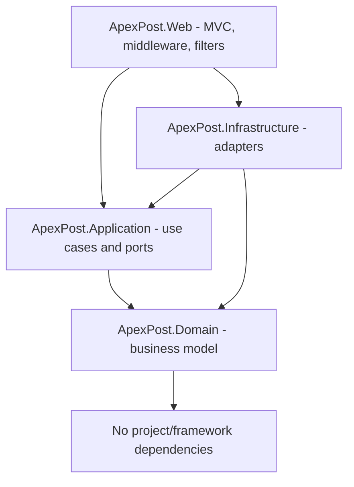
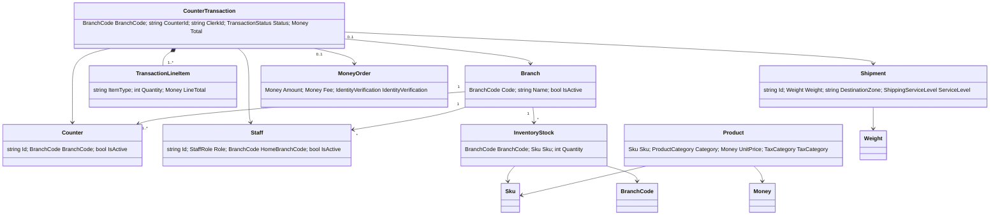
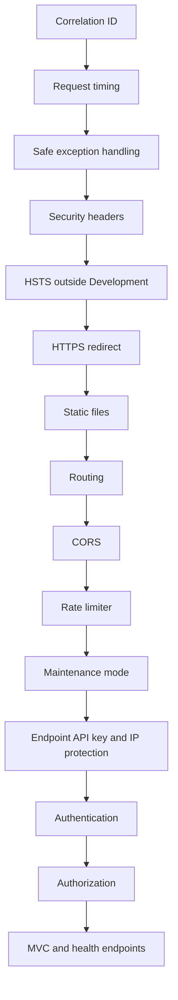

# ApexPost Counter Platform — Design

## Architecture style

Use DDD-inspired Clean Architecture. DDD models the business domain; Clean Architecture keeps framework and storage concerns outside the domain. The architecture is intentionally pragmatic: introduce aggregates and value objects where they protect business invariants, rather than adding patterns without a business reason.

## Dependency direction

The Web project is the composition root and registers Application and Infrastructure services. Domain must not reference ASP.NET Core, JSON files, controllers, or Infrastructure. Application defines ports; Infrastructure implements them.

## Project references

| Project | References |
|---|---|
| Domain | None |
| Application | Domain |
| Infrastructure | Application, Domain |
| Web | Application, Infrastructure |
| Domain.Tests | Domain |
| Application.Tests | Application, Domain |
| Web.IntegrationTests | Web, `Microsoft.AspNetCore.Mvc.Testing` |

## Initial domain boundaries

- Counter transactions: lifecycle, line items, totals, payment state, void/refund rules.
- Inventory: stock per branch and stock adjustment invariants.
- Shipping: parcel/letter details, service level, destination zone and pricing.
- Money orders and identity verification: configurable threshold and masked document identifier.
- Branches, counters, staff and products: reference/business entities with explicit active status.

The transaction owns its lifecycle, totals and composed line items. Inventory remains an independent aggregate reserved through the application boundary; shipment and money-order records remain separate and reference the transaction. This keeps business rules testable while making the JSON workflow's compensating, non-atomic writes explicit.

Retail goods and services share the transaction's composed line-item list; a line's item type distinguishes retail from service without coupling transaction lifecycle to separate product/shipping inheritance trees.

## SOLID mapping

| Principle | Application here |
|---|---|
| Single Responsibility | Domain entities enforce invariants, Application services orchestrate use cases, JSON repositories persist data, and MVC controllers translate HTTP inputs/results. |
| Open/Closed | `IReportDataSource` and repository ports allow storage/report adapters to change without changing report calculations. Shipping prices are supplied as configured `ShippingPricingRule` instances. |
| Liskov Substitution | JSON repository implementations satisfy Application repository interfaces and can be replaced by test fakes or later adapters. |
| Interface Segregation | Branch, counter, staff, product, inventory, transaction, shipment and money-order ports expose focused operations. |
| Dependency Inversion | Application depends on Domain and abstractions; Infrastructure implements repository/report/audit ports; Web is the composition root. |

## Persistence

This week uses asynchronous JSON persistence behind repository interfaces; no database or ORM. `JsonPersistenceOptions.DataDirectory` defaults to `<solution-root>/App_Data` when the running assembly can locate `ApexPost.sln`, falling back to `AppContext.BaseDirectory/App_Data` otherwise. Web startup binds the optional `JsonPersistence:DataDirectory` setting; an absolute path is recommended for deployment. Missing entity files read as empty collections and are created on the first write. The JSON entity files are `branches.json`, `counters.json`, `staff.json`, `staff-credentials.json`, `products.json`, `inventory.json`, `counter-transactions.json`, `shipments.json`, and `money-orders.json`; action audit entries are appended separately to `audit.jsonl` in the same directory. The opt-in console project `tools/ApexPost.DemoSeed` creates synthetic records only in an existing empty directory. It records digests in a manifest and refuses changed or unrelated data on repeat invocation. It is not a Web endpoint or a production startup hook. There are no production seed files or credentials.

`CounterTransaction.OccurredAtUtc` is optional so existing JSON remains readable. New counter sales and seeded sample sales record a UTC occurrence time. `JsonReportDataSource` excludes older records with no timestamp from date-based reporting instead of inventing historical dates. No automatic rewrite or migration of the existing `App_Data` JSON is performed. Reporting reads the JSON branch, inventory, product, transaction, shipment, and money-order repositories through `IReportDataSource`; sales are split by retail/service line and include the saved transaction tax rates. The branch dashboard loads daily sales and low-stock data concurrently. Managers are scoped to their home branch; auditors and administrators can view cross-branch reports.

`InventoryService.AdjustQuantityAsync` delegates to the JSON repository's single-file mutation path. The update is serialized with sales reservations and validates the domain stock rule before replacing `inventory.json`. This is atomic within the running process for the inventory file; it does not create a transaction spanning multiple JSON files. Admin staff creation writes the staff record and password hash to two separate JSON files, so a process failure between those writes can leave an account requiring administrative recovery.

## Advanced C# and performance choices

| Technique | Use in this solution | Status |
|---|---|---|
| Records and value objects | Report DTOs and `Money`, `Weight`, `Sku`, `BranchCode`, and `Address` keep values explicit and validated. | Used |
| Pattern matching | Domain item-type validation and role/state branches keep supported cases explicit. | Used |
| Generic repository | `JsonFileStore<TEntity> where TEntity : class` shares asynchronous JSON CRUD and key handling without exposing storage to use cases. | Used |
| Delegates | Key selectors and report repository callbacks keep generic persistence/report orchestration reusable. | Used |
| Events | `SimulatedNotificationService.NotificationPublished` exposes low-stock, high-value money-order, void, and refund notifications to observers. | Used |
| Async and cancellation | Controllers and use cases pass cancellation through JSON repository I/O; cancellation is propagated separately from ordinary persistence failures. | Used |
| `Task.WhenAll` | The dashboard, reports, and independent option loads request separate repositories concurrently. | Used |
| `SemaphoreSlim` | JSON file gates serialize writes by full path; inventory reservations are bounded within the process. | Used |
| C# 14 extension members | `decimal.ToCurrencyPrecision()` centralizes the two-decimal, midpoint-away-from-zero rule used by `Money`. | Used |
| C# 14 `field` keyword | `InventoryStock.Quantity` validates the non-negative invariant in its setter, including constructor/deserialization paths, without a manually declared backing field. | Used |
| Custom attributes and reflection | `RequiredTextAttribute` and `MaskedIdentifierAttribute` decorate transaction request records. `AttributeObjectValidator` caches per-type property/attribute metadata in a `ConcurrentDictionary` and validates nested request objects before the sale use case runs. | Used |
| `ValueTask` and in-memory cache | The singleton `ProductCatalogCache` stores immutable products for two minutes. A cache hit returns a completed `ValueTask` and counter-sale option loading warms it before line-item lookup. The catalog has no Web write path; a future writer must call `Invalidate`, and concurrent cache misses are not coalesced. | Used |
| Courier timeout and cancellation | `CourierStatusService` bounds concurrent processing to four operations, links the request token with a configured timeout, and maps timeout to 504 while caller cancellation propagates. A configurable delay simulates a slow courier lookup; the current integration is a webhook plus local JSON lookup, not a real outbound carrier API. | Used (simulation) |

The report data source uses repository abstractions and DTO projections rather than loading files directly in controllers. Dashboard/report fan-out is safe for independent read operations. File writes remain serialized per path to prevent lost updates. `ProductCatalogCacheTests` compares 100 direct reads against 100 warm cache hits over a fake repository that waits 1 ms per read. On the local test run, direct reads took 1,522.39 ms and cache hits took 0.24 ms. This is a small latency demonstration, not a production benchmark: it excludes JSON parsing, competing cache misses, expiration, and real workload variance. The cache avoids repeated repository I/O for an immutable, repeatedly read catalogue; the dictionary lookup itself is not expected to beat an already in-memory `Task.FromResult` repository.

`JsonFileStore<TEntity>` writes a complete entity collection to a unique temporary file in the target directory, flushes it, then moves it over the destination. A static per-full-path `SemaphoreSlim` coordinates store instances in the same process for the same entity type. Missing files are treated as empty; malformed JSON, permission errors, and I/O failures propagate to the safe HTTP exception handler (or the caller outside Web). A process failure may leave a temporary file or a partial final audit line. Entity-file replacement does not create a transaction across files. The counter-sale service compensates some failed multi-file writes, but a process crash or multiple application instances can still leave inventory, shipment, and transaction data inconsistent. This is not a database transaction or a cross-process lock. Backups, file permissions, durable recovery, and single-instance deployment remain operational requirements until a transactional store is introduced.

## Cross-cutting concerns

- Middleware: HTTP request/response concerns such as exception handling, correlation, request timing, security headers, maintenance mode and endpoint protection.
- MVC action filters: action-context concerns such as audit metadata, model-state handling and action duration.
- Diagnostic logs use `ILogger<T>`. Business audit records use `IAuditStore` and must exclude secrets, card data, passwords and full identity document numbers.

### Middleware versus filters

| Concern | Mechanism | Reason |
|---|---|---|
| Correlation ID, request timing, exception conversion and security headers | Middleware | Applies to the whole HTTP pipeline, including static files and requests that never enter MVC. |
| Maintenance mode, endpoint API key and IP allowlist | Middleware | Uses request configuration and endpoint metadata before controller execution. |
| MVC audit record | Action filter | Needs controller/action, route values, result status and staff claims. |
| MVC model-state response handling | Action filter | Runs after MVC model binding and before action execution. |
| MVC action duration warning | Action filter | Measures action execution and knows MVC route identity; threshold is configurable. |

### DI lifetimes

| Service | Lifetime | Reason |
|---|---|---|
| JSON repositories and audit store | Singleton | Share per-file gates and persistence coordination across requests. |
| `ProductCatalogCache`, notification observer and `TimeProvider` | Singleton | Cache/notification state and clock are shared; cache entries are immutable and expire. |
| Application use-case services and `IReportDataSource` | Scoped | Request orchestration can safely depend on singleton repositories without holding request state across requests. |
| MVC action filters | Scoped | Use request/action context and may depend on audit/options services. |
| Custom middleware | Singleton middleware construction | Constructors use singleton-safe configuration/loggers; request-specific services must be passed to `InvokeAsync`, not captured by the middleware constructor. |

### Security and audit threats

| Threat | Mitigation |
|---|---|
| Credential theft or brute force | Hashed staff passwords, secure HttpOnly/SameSite cookies, login rate limit, no public registration. |
| Forged state-changing browser request | Antiforgery token on each MVC POST; authorization checks on server-derived staff/branch records. |
| Leaked integration key or unauthorized caller | Key from user-secrets/environment, constant-time comparison, IP allowlist, partner rate limit; no key in source or audit. |
| Forged client IP behind a proxy | Forwarded headers are disabled unless trusted proxies/networks are explicitly configured; allowlists otherwise use the direct remote IP. |
| Cross-branch data access | Branch-aware use cases/controllers; branch managers are scoped to their home branch; admin endpoints additionally use the configured IP allowlist. |
| Personal or payment data in logs | Audit filter records route metadata only, excludes sensitive route keys, and does not inspect form values/action arguments. Identity numbers are stored masked; card data is not collected. |
| Lost update or negative stock | Per-file semaphore and atomic JSON replacement; stock reservation checks all requested lines before decrement. |
| File tampering, crash or multi-instance inconsistency | Restrict data-directory permissions and back up files; documented limitation is single-process/single-instance and non-atomic multi-file workflows. |

### Middleware and filters

The Web pipeline runs these components in order:

1. `CorrelationIdMiddleware` validates or generates `X-Correlation-Id`, echoes it, stores it for the request, and opens a structured logging scope.
2. `RequestTimingMiddleware` wraps the remaining request pipeline in `try/finally` and logs the final response status and elapsed time, including handled exceptions.
3. `SafeExceptionMiddleware` converts unhandled exceptions to generic `application/problem+json` responses containing trace/correlation identifiers. Exception details stay in server logs.
4. `SecurityHeadersMiddleware` uses `OnStarting` for the CSP, nosniff, frame, and referrer headers. The CSP nonce is applied to the layout's small early theme script.
5. Built-in HSTS runs outside Development, followed by HTTPS redirection and static files.
6. Routing runs before CORS so CORS can use endpoint metadata. CORS is only applied to explicitly opted-in endpoints and allows only `Integration:AllowedOrigin`; CORS is a browser policy, not authentication.
7. Rate limiting, maintenance mode, endpoint API-key/IP checks, authentication, and authorization run before controller actions.
8. MVC routes and `/health` are mapped. Maintenance mode exempts `/health` and returns `503` with a configured `Retry-After` value for other requests.

API-key and IP protections are opt-in through endpoint metadata (`ApiKeyProtectedAttribute` and `IpAllowlistProtectedAttribute`). API keys come from `Integration:ApiKey` (for local development, user-secrets); no production key is checked in. A protected endpoint with missing key configuration fails closed with `500`; missing/invalid client keys receive `401`. IP allowlists use the connection's remote IP and exact configured addresses.

The app intentionally does not enable forwarded headers by default. Behind a reverse proxy, the connection IP is the proxy address. Forwarded headers must only be enabled after the deployment configures explicit trusted proxies/networks; otherwise a client can spoof `X-Forwarded-For` and bypass IP restrictions. Until such configuration exists, allowlists must account for the observed proxy IP or be enforced at a trusted edge.

The global MVC filters have separate jobs: `ValidationActionFilter` sets the standard `400` status for invalid bound models while allowing MVC actions to redisplay their typed form; `PerformanceActionFilter` logs MVC action execution duration at Debug and warns above the configured `Observability:MVCSlowActionWarningMilliseconds` threshold; `AuditActionFilter` appends action identity, safe route metadata, result status, duration, staff claims, and correlation ID through the Application `IAuditStore` port. It never reads form/query values or action arguments. Request timing belongs in middleware because it covers static files and short-circuited requests; audit and action timing need MVC route, result, and user context, so they belong in filters.

The courier integration is exposed at `POST /api/integrations/courier/shipments/{shipmentId}/status`. It is opted into the API-key, exact-IP allowlist, partner CORS and partner rate-limit policies through endpoint metadata. A valid JSON body is `{ "status": "In transit" }`; the action delegates to the Application shipping service and persists the reported status and UTC receipt time through `IShipmentRepository`. The service bounds concurrent lookups to four, applies `Shipping:CourierTrackingTimeoutSeconds`, passes linked cancellation to storage, and maps its own timeout to 504; a canceled HTTP request remains cancellation. `Shipping:SimulatedTrackingDelayMilliseconds` can demonstrate the slow-courier path and defaults to zero. Missing shipments return 404 and invalid status/input returns 400. Missing or invalid partner keys return 401; missing server-side key configuration fails closed with 500; blocked remote IPs return 403; the partner rate limiter returns 429. The configured partner key receives a shared partner bucket; invalid requests are bucketed by remote IP. CORS only controls browser access and is not authentication. The route does not enable forwarded headers, so deployments behind a proxy must use an explicitly trusted proxy configuration before using forwarded client addresses.

Administrator staff-management endpoints carry `IpAllowlistProtected("Security:AdminAllowedIps")` metadata in addition to role authorization. Configure the allowlist in deployment configuration; it is fail-closed when absent. The MVC performance filter uses `Observability:MVCSlowActionWarningMilliseconds` (500 ms by default) to log slow actions at Warning and faster actions at Debug.

Counter sales are created through the MVC form at `/Transactions/Create`. The POST binds only counter, product SKU/quantity, optional shipping or money-order details, and payment method. The Application service reloads the actual staff, branch, counter, products, prices and tax rates; branch and staff identity come from verified cookie claims and are checked against repository records. It rejects inactive staff/counters/branches, a closed branch, unrecognized products, invalid payment or shipping values, and insufficient inventory. Current product and configured shipping prices are used to create a Paid transaction with retail and service lines. A money order is prepared with its configured fee and threshold, linked to the generated transaction and branch, and persisted with a tax-exempt service line. Above the threshold, the same request must contain a successful staff-recorded identity check; only a strict masked identifier (`XXXX` plus four visible characters) is accepted. The order is written before the transaction and deleted during compensation if the transaction write fails. JSON files still cannot make this a crash-atomic operation. Shipping rules, money-order fee/threshold and tax rates are configuration driven; the checked-in values are demonstration defaults, not verified operational tariffs or tax guidance.

`JsonInventoryRepository.TryReserveAsync` performs an all-lines check and stock decrement under the shared per-file semaphore, then writes the updated inventory file atomically through a temporary file and rename. This prevents concurrent requests in the same application process from overselling stock and avoids partial updates when a basket has multiple SKUs. After reservation, the use case writes an optional shipment and/or money order and then the transaction. If a later write fails, it deletes any written shipment and money order and restores stock; a rollback failure throws an explicit recovery-required exception rather than reporting an ordinary failed sale. These are compensating writes across `inventory.json`, `shipments.json`, `money-orders.json`, and `counter-transactions.json`, not a crash-atomic transaction. A process/power failure between file replacements or multiple independent web processes can still leave inconsistent state; production multi-instance use needs an interprocess transaction/journal or a transactional store. Branch hours have no time-zone field in the domain, so this implementation evaluates configured opening times against the host's local clock.

The receipt is available to the originating clerk and branch staff at the same branch; Administrators can access receipts across branches. Shipment records retain their branch and transaction references. `/Transactions` and its details pages provide manager/administrator review. A void or full refund requires a reason and is only valid for a paid transaction. A void records state/reason but does not issue a refund; a refund records `Refunded` and publishes a simulated notification. There is no payment-provider reversal or partial refund model. Successful POSTs use PRG; antiforgery validation is required. MVC audit entries record the route/action and staff claims without reading submitted basket data or the void/refund reason.

Integration tests exercise the real courier endpoint and transaction MVC actions with isolated per-test JSON directories. Test-only probe endpoints remain solely for middleware branches that are not reachable through the production routes.

## Verification

Build and test with .NET 10. Capture actual command output and counts in the submission notes; do not claim unexecuted verification.
