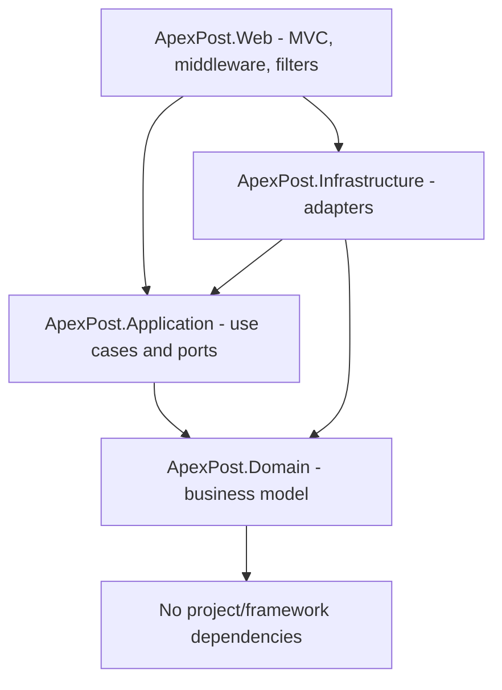
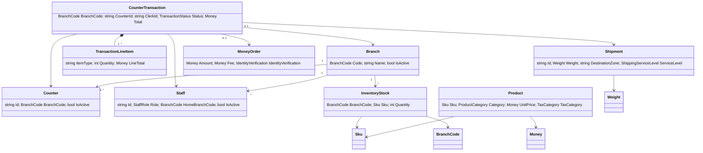
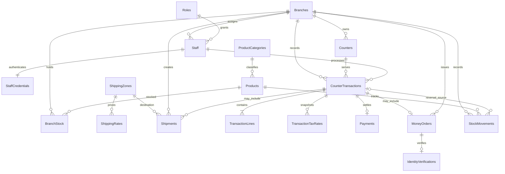
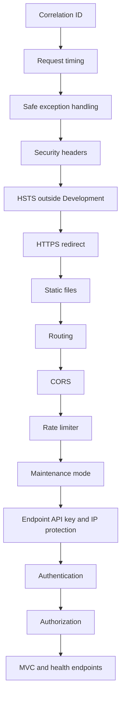

# ApexPost Counter Platform — Design

## Architecture style

Use DDD-inspired Clean Architecture. DDD models the business domain; Clean Architecture keeps framework and storage concerns outside the domain. The architecture is intentionally pragmatic: introduce aggregates and value objects where they protect business invariants, rather than adding patterns without a business reason.

## Dependency direction

The Web project is the composition root and registers Application and Infrastructure services. Domain must not reference ASP.NET Core, JSON files, controllers, or Infrastructure. Application defines ports; Infrastructure implements them.

## Runtime persistence (Week 3)

The running Web application registers the EF Core SQL Server adapters from `AddSqlInfrastructure`. Branch, counter, staff/credential, product, stock, transaction, shipment, money-order, report, unit-of-work, and audit operations resolve through scoped SQL implementations sharing the request's `ApexPostDbContext`. Web startup does not register JSON repositories or use JSON as a fallback. Missing SQL configuration fails startup with a message showing the Development user-secrets command. JSON adapters remain available to legacy tests and the explicit import tool only. No separate business database is used.

Development connection strings belong in user-secrets, and schema changes are applied explicitly with `dotnet ef database update`; Web startup does not migrate the database or use `EnsureCreated`. See [README.md](README.md) for setup and [docs/WEEK3-EF-IMPLEMENTATION.md](docs/WEEK3-EF-IMPLEMENTATION.md) for the migration/import procedure.

## Project references

| Project | References |
|---|---|
| Domain | None |
| Application | Domain |
| Infrastructure | Application, Domain |
| Web | Application, Infrastructure |
| Domain.Tests | Domain |
| Application.Tests | Application, Domain |
| Web.IntegrationTests | Web, `Microsoft.AspNetCore.Mvc.Testing` |

## Initial domain boundaries

- Counter transactions: lifecycle, line items, totals, payment state, void/refund rules.
- Inventory: stock per branch and stock adjustment invariants.
- Shipping: parcel/letter details, service level, destination zone and pricing.
- Money orders and identity verification: configurable threshold and masked document identifier.
- Branches, counters, staff and products: reference/business entities with explicit active status.

The transaction owns its lifecycle, totals and composed line items. Inventory remains an independent aggregate reserved through the application boundary; shipment and money-order records remain separate and reference the transaction. SQL persistence commits supported multi-entity sales and reversals through the scoped unit of work and database transaction/concurrency safeguards. Historical JSON adapters retain their earlier compensating-write limitations but are not part of the Web runtime.

## SQL Server relational ER diagram

The deployed schema adds normalized lookup, credential, payment, tax snapshot, movement, audit, and import tables. Historical/financial foreign keys restrict deletion (`NO ACTION`); the diagram omits scalar columns and lookup details for readability.

Retail goods and services share the transaction's composed line-item list; a line's item type distinguishes retail from service without coupling transaction lifecycle to separate product/shipping inheritance trees.

## SOLID mapping

| Principle | Application here |
|---|---|
| Single Responsibility | Domain entities enforce invariants, Application services orchestrate use cases, SQL repositories persist data, and MVC controllers translate HTTP inputs/results. |
| Open/Closed | `IReportDataSource` and repository ports allow storage/report adapters to change without changing report calculations. Shipping prices are supplied as configured `ShippingPricingRule` instances. |
| Liskov Substitution | SQL repository implementations satisfy Application repository interfaces and can be replaced by test fakes or isolated legacy adapters. |
| Interface Segregation | Branch, counter, staff, product, inventory, transaction, shipment and money-order ports expose focused operations. |
| Dependency Inversion | Application depends on Domain and abstractions; Infrastructure implements repository/report/audit ports; Web is the composition root. |

## Persistence

Web runtime business data uses EF Core 10 with SQL Server and the `ApexPostDb` catalog. The connection string is supplied through Development user-secrets or an explicit environment variable; startup does not migrate the database, call `EnsureCreated`, register JSON repositories, or fall back to JSON. Schema changes are applied explicitly through EF migrations. The SQL repositories, `ApexPostDbContext`, and `IUnitOfWork` are scoped and share one context within a request/use case.

Reads use no-tracking projections for reports and screens. Counter sale, stock reservation, payment, linked shipment/money-order, and reversal changes are staged through the unit of work and committed consistently. Stock and transaction rowversions, a unique reversal movement constraint, and database transactions protect concurrent writes. The stored procedures provide set-based daily sales and low-stock reports plus transactional stock adjustment; calls use parameterized EF APIs. Audit entries are written through the SQL audit store separately from the business commit so audit failure does not replace a completed business response.

JSON repositories remain only as legacy test adapters. The opt-in importer reads a selected JSON source without modifying it and writes imported rows to SQL explicitly; the original `App_Data` files are not changed by Web startup. The separate `--import-audit-jsonl` command imports only validated events from `audit.jsonl` into an already-populated SQL database and uses the import ledger for repeat-safe execution; it does not rerun or merge the full business import. The opt-in demo tool can create fictional JSON fixtures in a separate, explicitly selected empty directory. Its password is required through user-secrets or an environment variable and only the password hash is written to the fixture. Neither tool is a Web startup hook.

## Advanced C# and performance choices

| Technique | Use in this solution | Status |
|---|---|---|
| Records and value objects | Report DTOs and `Money`, `Weight`, `Sku`, `BranchCode`, and `Address` keep values explicit and validated. | Used |
| Pattern matching | Domain item-type validation and role/state branches keep supported cases explicit. | Used |
| Generic repository | `JsonFileStore<TEntity> where TEntity : class` supports isolated legacy JSON tests and the import source; SQL runtime uses focused EF repositories. | Legacy/import only |
| Delegates | A `Func<Weight, Money>` on `ShippingPricingRule` selects the real price calculation. The configured multiplier adjusts the default linear policy; callers/tests can supply a different policy without changing `ShippingService`. | Used |
| Events | `SimulatedNotificationService.NotificationPublished` exposes low-stock, high-value money-order, void, and refund notifications to observers. | Used |
| Async and cancellation | Controllers and use cases pass cancellation through SQL operations; cancellation is propagated separately from ordinary persistence failures. | Used |
| `Task.WhenAll` | The dashboard, reports, and independent option loads request separate repositories concurrently. | Used |
| `SemaphoreSlim` | JSON file gates support legacy adapters; SQL stock reservations use database transactions, conditional updates and concurrency tokens. | Used |
| C# 14 extension members | `decimal.ToCurrencyPrecision()` centralizes the two-decimal, midpoint-away-from-zero rule used by `Money`. | Used |
| C# 14 `field` keyword | `InventoryStock.Quantity` validates the non-negative invariant in its setter, including constructor/deserialization paths, without a manually declared backing field. | Used |
| Custom attributes and reflection | `RequiredTextAttribute` and `MaskedIdentifierAttribute` decorate transaction request records. `AttributeObjectValidator` caches per-type property/attribute metadata in a `ConcurrentDictionary` and validates nested request objects before the sale use case runs. | Used |
| `ValueTask` and in-memory cache | The scoped `ProductCatalogCache` stores products for two minutes against a scoped SQL repository. A cache hit returns a completed `ValueTask`; a future catalogue writer must call `Invalidate`. | Used |
| Courier timeout and cancellation | `CourierStatusService` bounds concurrent processing to four operations, links the request token with a configured timeout, and maps timeout to 504 while caller cancellation propagates. A configurable delay simulates a slow courier lookup; the webhook writes through the SQL shipment repository and is not a real outbound carrier API. | Used (simulation) |

The SQL report data source uses repository abstractions and no-tracking DTO projections rather than loading files in controllers. Dashboard/report reads are database queries. `ProductCatalogCacheTests` is a small fake-repository latency demonstration, not a production benchmark; it does not measure SQL throughput or real workload variance.

Shipping weight limits are independently configured under `Shipping:MaximumWeightKgByServiceLevel`. The checked-in values (Standard 30 kg, Express 20 kg, Registered 10 kg) are demonstration assumptions, not assignment-provided business policy. Replace them with approved values. `ShippingPricingRule` uses a `Func<Weight, Money>` to run the configured pricing policy; the default linear rule applies `Shipping:PriceMultiplier` to the base-plus-weight price. A different delegate can implement another pricing policy without changing shipment orchestration.

`JsonFileStore<TEntity>` remains an isolated legacy adapter and a source reader for import; it is not part of the Web runtime composition. Its prior Week 2 atomic-file and multi-file compensation limits are historical behavior and do not describe SQL-backed Web operations. SQL sale and reversal writes use the scoped unit of work and database constraints/transactions; see [WEEK3-EF-IMPLEMENTATION.md](docs/WEEK3-EF-IMPLEMENTATION.md) for remaining SQL limitations.

## Cross-cutting concerns

- Middleware: HTTP request/response concerns such as exception handling, correlation, request timing, security headers, maintenance mode and endpoint protection.
- MVC action filters: action-context concerns such as audit metadata, model-state handling and action duration.
- Diagnostic logs use `ILogger<T>`. Business audit records use `IAuditStore` and must exclude secrets, card data, passwords and full identity document numbers.

### Middleware versus filters

| Concern | Mechanism | Reason |
|---|---|---|
| Correlation ID, request timing, exception conversion and security headers | Middleware | Applies to the whole HTTP pipeline, including static files and requests that never enter MVC. |
| Maintenance mode, endpoint API key and IP allowlist | Middleware | Uses request configuration and endpoint metadata before controller execution. |
| MVC audit record | Action filter | Needs controller/action, route values, result status and staff claims. |
| MVC model-state response handling | Action filter | Runs after MVC model binding and before action execution. |
| MVC action duration warning | Action filter | Measures action execution and knows MVC route identity; threshold is configurable. |

### DI lifetimes

| Service | Lifetime | Reason |
|---|---|---|
| SQL repositories, audit store, `ApexPostDbContext`, and `IUnitOfWork` | Scoped | One request scope shares a context and unit of work; SQL changes are committed at the use-case boundary. |
| `ProductCatalogCache` and Application use-case services | Scoped | The cache depends on a scoped SQL repository; use-case dependencies remain within the request scope. |
| Notification observer and `TimeProvider` | Singleton | The notification simulation and system clock are shared. |
| JSON repositories and audit store | Not registered in Web | They remain available for legacy tests/import tooling only. |
| `IReportDataSource` | Scoped | Report reads use SQL projections within the request's context. |
| MVC action filters | Scoped | Use request/action context and may depend on audit/options services. |
| Custom middleware | Singleton middleware construction | Constructors use singleton-safe configuration/loggers; request-specific services must be passed to `InvokeAsync`, not captured by the middleware constructor. |

### Security and audit threats

| Threat | Mitigation |
|---|---|
| Credential theft or brute force | Hashed staff passwords, secure HttpOnly/SameSite cookies, login rate limit, no public registration. |
| Forged state-changing browser request | Antiforgery token on each MVC POST; authorization checks on server-derived staff/branch records. |
| Leaked integration key or unauthorized caller | Key from user-secrets/environment, constant-time comparison, IP allowlist, partner rate limit; no key in source or audit. |
| Forged client IP behind a proxy | Forwarded headers are disabled unless trusted proxies/networks are explicitly configured; allowlists otherwise use the direct remote IP. |
| Cross-branch data access | Branch-aware use cases/controllers; branch managers are scoped to their home branch; admin endpoints additionally use the configured IP allowlist. |
| Personal or payment data in logs | Audit filter records route metadata only, excludes sensitive route keys, and does not inspect form values/action arguments. Identity numbers are stored masked; card data is not collected. |
| Lost update or negative stock | SQL stock reservation, rowversion concurrency, database constraints, and one unit-of-work transaction protect the reservation and sale. |
| Database availability or migration mismatch | SQL is the only Web runtime source; startup does not silently fall back to JSON. Apply reviewed migrations explicitly and keep tested backups. |

### Middleware and filters

The Web pipeline runs these components in order:

1. `CorrelationIdMiddleware` validates or generates `X-Correlation-Id`, echoes it, stores it for the request, and opens a structured logging scope. The Console formatter has `IncludeScopes` enabled in `appsettings.json`, so the default local log output includes the correlation ID on request log entries.
2. `RequestTimingMiddleware` wraps the remaining request pipeline in `try/finally` and logs the final response status and elapsed time, including handled exceptions.
3. `SafeExceptionMiddleware` converts unhandled exceptions to generic `application/problem+json` responses containing trace/correlation identifiers. Exception details stay in server logs.
4. `SecurityHeadersMiddleware` uses `OnStarting` for the CSP, nosniff, frame, and referrer headers. The CSP nonce is applied to the layout's small early theme script.
5. Built-in HSTS runs outside Development, followed by HTTPS redirection and static files.
6. Routing runs before CORS so CORS can use endpoint metadata. CORS is only applied to explicitly opted-in endpoints and allows only `Integration:AllowedOrigin`; CORS is a browser policy, not authentication.
7. Rate limiting, maintenance mode, endpoint API-key/IP checks, authentication, and authorization run before controller actions.
8. MVC routes and `/health` are mapped. Maintenance mode exempts `/health` and returns `503` with a configured `Retry-After` value for other requests.

API-key and IP protections are opt-in through endpoint metadata (`ApiKeyProtectedAttribute` and `IpAllowlistProtectedAttribute`). API keys come from `Integration:ApiKey` (for local development, user-secrets); no production key is checked in. A protected endpoint with missing key configuration fails closed with `500`; missing/invalid client keys receive `401`. IP allowlists use the connection's remote IP and exact configured addresses.

The app intentionally does not enable forwarded headers by default. Behind a reverse proxy, the connection IP is the proxy address. Forwarded headers must only be enabled after the deployment configures explicit trusted proxies/networks; otherwise a client can spoof `X-Forwarded-For` and bypass IP restrictions. Until such configuration exists, allowlists must account for the observed proxy IP or be enforced at a trusted edge.

The global MVC filters have separate jobs: `ValidationActionFilter` returns a `400` validation result without invoking ordinary invalid actions. Form POST actions that deliberately rebuild a view are marked with `RedisplayInvalidModelStateAttribute`; those actions retain validation messages and repopulate their select options. `PerformanceActionFilter` logs MVC action execution duration at Debug and warns above the configured `Observability:MVCSlowActionWarningMilliseconds` threshold. `AuditActionFilter` records selected business POST actions through the Application `IAuditStore` port. Audit entries contain action-specific safe identifiers (transaction IDs, adjustment branch/SKU, or courier shipment ID), result status, duration, staff claims, and correlation ID. The filter does not read form/query values or include generic route `id` values. Audit write failures are logged and do not replace an already determined business response. Request timing belongs in middleware because it covers static files and short-circuited requests; audit and action timing need MVC route, result, and user context, so they belong in filters.

The courier integration is exposed at `POST /api/integrations/courier/shipments/{shipmentId}/status`. It is opted into the API-key, exact-IP allowlist, partner CORS and partner rate-limit policies through endpoint metadata. A valid JSON body is `{ "status": "In transit" }`; the action delegates to the Application shipping service and persists the reported status and UTC receipt time through `IShipmentRepository`. The service bounds concurrent lookups to four, applies `Shipping:CourierTrackingTimeoutSeconds`, passes linked cancellation to storage, and maps its own timeout to 504; a canceled HTTP request remains cancellation. `Shipping:SimulatedTrackingDelayMilliseconds` can demonstrate the slow-courier path and defaults to zero. Missing shipments return 404 and invalid status/input returns 400. Missing or invalid partner keys return 401; missing server-side key configuration fails closed with 500; blocked remote IPs return 403; the partner rate limiter returns 429. The configured partner key receives a shared partner bucket; invalid requests are bucketed by remote IP. CORS only controls browser access and is not authentication. The route does not enable forwarded headers, so deployments behind a proxy must use an explicitly trusted proxy configuration before using forwarded client addresses.

Administrator staff-management endpoints carry `IpAllowlistProtected("Security:AdminAllowedIps")` metadata in addition to role authorization. Configure the allowlist in deployment configuration; it is fail-closed when absent. The MVC performance filter uses `Observability:MVCSlowActionWarningMilliseconds` (500 ms by default) to log slow actions at Warning and faster actions at Debug.

Counter sales are created through the MVC form at `/Transactions/Create`. The POST binds only counter, product SKU/quantity, optional shipping or money-order details, and payment method. The Application service reloads the actual staff, branch, counter, products, prices and tax rates; branch and staff identity come from verified cookie claims and are checked against repository records. It rejects inactive staff/counters/branches, a closed branch, unrecognized products, invalid payment or shipping values, and insufficient inventory. Current product and configured shipping prices are used to create a Paid transaction with retail and service lines. A money order is prepared with its configured fee and threshold, linked to the generated transaction and branch, and persisted with a tax-exempt service line. Above the threshold, the same request must contain a successful staff-recorded identity check; only a strict masked identifier (`XXXX` plus four visible characters) is accepted. The order is written before the transaction and deleted during compensation if the transaction write fails. JSON files still cannot make this a crash-atomic operation. Shipping rules, money-order fee/threshold and tax rates are configuration driven; the checked-in values are demonstration defaults, not verified operational tariffs or tax guidance.

`JsonInventoryRepository.TryReserveAsync` performs an all-lines check and stock decrement under the shared per-file semaphore, then writes the updated inventory file atomically through a temporary file and rename. This prevents concurrent requests in the same application process from overselling stock and avoids partial updates when a basket has multiple SKUs. After reservation, the use case writes an optional shipment and/or money order and then the transaction. If a later write fails, it deletes any written shipment and money order and restores stock; a rollback failure throws an explicit recovery-required exception rather than reporting an ordinary failed sale. These are compensating writes across `inventory.json`, `shipments.json`, `money-orders.json`, and `counter-transactions.json`, not a crash-atomic transaction. A process/power failure between file replacements or multiple independent web processes can still leave inconsistent state; production multi-instance use needs an interprocess transaction/journal or a transactional store. Branch hours have no time-zone field in the domain, so this implementation evaluates configured opening times against the host's local clock.

The receipt is available to the originating clerk and branch staff at the same branch; Administrators can access receipts across branches. Shipment records retain their branch and transaction references, and receipt links select the service line's shipment reference instead of a preceding retail SKU. `/Transactions` and its details pages provide manager/administrator review. A void or full refund requires a reason and is only valid for a paid transaction. Both restore eligible retail quantities to the transaction branch through one inventory-file mutation. The JSON inventory repository remembers restored transaction IDs in memory so a stock-write failure leaves the transaction paid and a retry after a transaction-write failure does not add the same stock twice. This does not cover a process crash between the inventory and transaction file writes or multiple application processes; that limitation and the persistent-ledger/database path are recorded in ADR-0014. Older transactions without SKU references cannot be restored automatically. Neither workflow cancels shipments or money orders. A void records state/reason but does not issue a refund; a refund records `Refunded` and publishes a simulated notification. There is no payment-provider reversal or partial refund model. Successful POSTs use PRG; antiforgery validation is required. MVC audit entries record safe business identifiers and staff claims without reading submitted basket data or the void/refund reason.

Integration tests exercise the real courier endpoint and transaction MVC actions with isolated per-test JSON directories. Test-only probe endpoints remain solely for middleware branches that are not reachable through the production routes.

## Verification

Build and test with .NET 10. Capture actual command output and counts in the submission notes; do not claim unexecuted verification.
