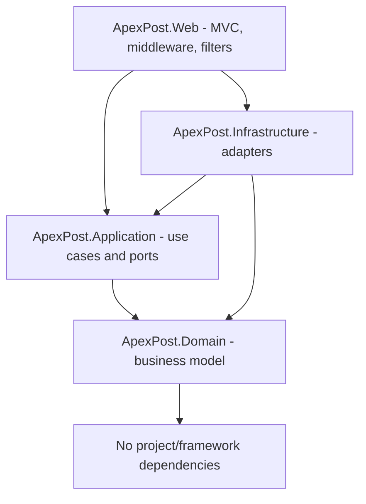

# ApexPost Counter Platform — Design

## Architecture style

Use DDD-inspired Clean Architecture. DDD models the business domain; Clean Architecture keeps framework and storage concerns outside the domain. The architecture is intentionally pragmatic: introduce aggregates and value objects where they protect business invariants, rather than adding patterns without a business reason.

## Dependency direction

The Web project is the composition root and registers Application and Infrastructure services. Domain must not reference ASP.NET Core, JSON files, controllers, or Infrastructure. Application defines ports; Infrastructure implements them.

## Project references

| Project | References |
|---|---|
| Domain | None |
| Application | Domain |
| Infrastructure | Application, Domain |
| Web | Application, Infrastructure |
| Domain.Tests | Domain |
| Application.Tests | Application, Domain |
| Web.IntegrationTests | Web, `Microsoft.AspNetCore.Mvc.Testing` |

## Initial domain boundaries

- Counter transactions: lifecycle, line items, totals, payment state, void/refund rules.
- Inventory: stock per branch and stock adjustment invariants.
- Shipping: parcel/letter details, service level, destination zone and pricing.
- Money orders and identity verification: configurable threshold and masked document identifier.
- Branches, counters, staff and products: reference/business entities with explicit active status.

Aggregate boundaries will be finalized before domain implementation. Do not assume every concept belongs inside the counter transaction aggregate.

## Persistence

This week uses asynchronous JSON persistence behind repository interfaces; no database or ORM. Repository operations must accept `CancellationToken`. JSON writes must be coordinated to prevent lost updates. A semaphore around individual writes does not by itself make a multi-file business operation atomic; consistency limits and recovery behavior must be documented and tested.

## Cross-cutting concerns

- Middleware: HTTP request/response concerns such as exception handling, correlation, request timing, security headers, maintenance mode and endpoint protection.
- MVC action filters: action-context concerns such as audit metadata, model-state handling and action duration.
- Diagnostic logs use `ILogger<T>`. Business audit records use `IAuditStore` and must exclude secrets, card data, passwords and full identity document numbers.

## Verification

Build and test with .NET 10. Capture actual command output and counts in the submission notes; do not claim unexecuted verification.
