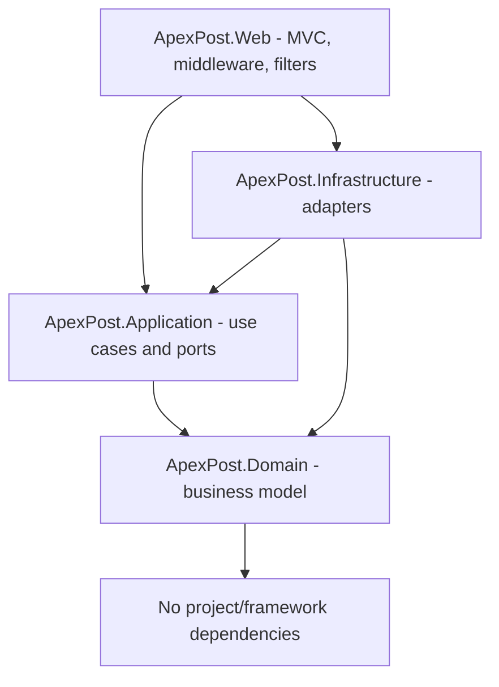

# ApexPost Counter Platform — Design

## Architecture style

Use DDD-inspired Clean Architecture. DDD models the business domain; Clean Architecture keeps framework and storage concerns outside the domain. The architecture is intentionally pragmatic: introduce aggregates and value objects where they protect business invariants, rather than adding patterns without a business reason.

## Dependency direction

The Web project is the composition root and registers Application and Infrastructure services. Domain must not reference ASP.NET Core, JSON files, controllers, or Infrastructure. Application defines ports; Infrastructure implements them.

## Project references

| Project | References |
|---|---|
| Domain | None |
| Application | Domain |
| Infrastructure | Application, Domain |
| Web | Application, Infrastructure |
| Domain.Tests | Domain |
| Application.Tests | Application, Domain |
| Web.IntegrationTests | Web, `Microsoft.AspNetCore.Mvc.Testing` |

## Initial domain boundaries

- Counter transactions: lifecycle, line items, totals, payment state, void/refund rules.
- Inventory: stock per branch and stock adjustment invariants.
- Shipping: parcel/letter details, service level, destination zone and pricing.
- Money orders and identity verification: configurable threshold and masked document identifier.
- Branches, counters, staff and products: reference/business entities with explicit active status.

Aggregate boundaries will be finalized before domain implementation. Do not assume every concept belongs inside the counter transaction aggregate.

## Persistence

This week uses asynchronous JSON persistence behind repository interfaces; no database or ORM. `JsonPersistenceOptions.DataDirectory` defaults to `AppContext.BaseDirectory/App_Data`; Web startup binds the optional `JsonPersistence:DataDirectory` setting, with an absolute path recommended for deployment. Missing entity files read as empty collections and are created on the first write. The JSON entity files are `branches.json`, `counters.json`, `staff.json`, `staff-credentials.json`, `products.json`, `inventory.json`, `counter-transactions.json`, `shipments.json`, and `money-orders.json`; action audit entries are appended separately to `audit.jsonl` in the same directory. No production seed files are currently supplied.

`JsonFileStore<TEntity>` writes a complete entity collection to a unique temporary file in the target directory, flushes it, then moves it over the destination. A static per-full-path `SemaphoreSlim` coordinates store instances in the same process for the same entity type. Missing files are treated as empty; malformed JSON, permission errors, and I/O failures propagate to the safe HTTP exception handler (or the caller outside Web). A process failure may leave a temporary file or a partial final audit line. Entity-file replacement does not create a transaction across files. The counter-sale service compensates some failed multi-file writes, but a process crash or multiple application instances can still leave inventory, shipment, and transaction data inconsistent. This is not a database transaction or a cross-process lock. Backups, file permissions, durable recovery, and single-instance deployment remain operational requirements until a transactional store is introduced.

## Cross-cutting concerns

- Middleware: HTTP request/response concerns such as exception handling, correlation, request timing, security headers, maintenance mode and endpoint protection.
- MVC action filters: action-context concerns such as audit metadata, model-state handling and action duration.
- Diagnostic logs use `ILogger<T>`. Business audit records use `IAuditStore` and must exclude secrets, card data, passwords and full identity document numbers.

### Middleware and filters

The Web pipeline runs these components in order:

1. `CorrelationIdMiddleware` validates or generates `X-Correlation-Id`, echoes it, stores it for the request, and opens a structured logging scope.
2. `RequestTimingMiddleware` wraps the remaining request pipeline in `try/finally` and logs the final response status and elapsed time, including handled exceptions.
3. `SafeExceptionMiddleware` converts unhandled exceptions to generic `application/problem+json` responses containing trace/correlation identifiers. Exception details stay in server logs.
4. `SecurityHeadersMiddleware` uses `OnStarting` for the CSP, nosniff, frame, and referrer headers. The CSP nonce is applied to the layout's small early theme script.
5. Built-in HSTS runs outside Development, followed by HTTPS redirection and static files.
6. Routing runs before CORS so CORS can use endpoint metadata. CORS is only applied to explicitly opted-in endpoints and allows only `Integration:AllowedOrigin`; CORS is a browser policy, not authentication.
7. Rate limiting, maintenance mode, endpoint API-key/IP checks, authentication, and authorization run before controller actions.
8. MVC routes and `/health` are mapped. Maintenance mode exempts `/health` and returns `503` with a configured `Retry-After` value for other requests.

API-key and IP protections are opt-in through endpoint metadata (`ApiKeyProtectedAttribute` and `IpAllowlistProtectedAttribute`). API keys come from `Integration:ApiKey` (for local development, user-secrets); no production key is checked in. A protected endpoint with missing key configuration fails closed with `500`; missing/invalid client keys receive `401`. IP allowlists use the connection's remote IP and exact configured addresses.

The app intentionally does not enable forwarded headers by default. Behind a reverse proxy, the connection IP is the proxy address. Forwarded headers must only be enabled after the deployment configures explicit trusted proxies/networks; otherwise a client can spoof `X-Forwarded-For` and bypass IP restrictions. Until such configuration exists, allowlists must account for the observed proxy IP or be enforced at a trusted edge.

The global MVC filters have separate jobs: `ValidationActionFilter` sets the standard `400` status for invalid bound models while allowing MVC actions to redisplay their typed form; `PerformanceActionFilter` logs MVC action execution duration at Debug level; `AuditActionFilter` appends action identity, safe route metadata, result status, duration, staff claims, and correlation ID through the Application `IAuditStore` port. It never reads form/query values or action arguments. Request timing belongs in middleware because it covers static files and short-circuited requests; audit and action timing need MVC route, result, and user context, so they belong in filters.

The courier integration is exposed at `POST /api/integrations/courier/shipments/{shipmentId}/status`. It is opted into the API-key, exact-IP allowlist, partner CORS and partner rate-limit policies through endpoint metadata. A valid JSON body is `{ "status": "In transit" }`; the action delegates to the Application shipping service and persists the reported status and UTC receipt time through `IShipmentRepository`. Missing shipments return 404 and invalid status/input returns 400. Missing or invalid partner keys return 401; missing server-side key configuration fails closed with 500; blocked remote IPs return 403; the partner rate limiter returns 429. CORS only controls browser access and is not authentication. The route does not enable forwarded headers, so deployments behind a proxy must use an explicitly trusted proxy configuration before using forwarded client addresses.

Counter sales are created through the MVC form at `/Transactions/Create`. The POST binds only counter, product SKU/quantity, optional shipping details, and payment method. The Application service reloads the actual staff, branch, counter, products, prices and tax rates; branch and staff identity come from verified cookie claims and are checked against repository records. It rejects inactive staff/counters/branches, a closed branch, unrecognized products, invalid payment or shipping values, and insufficient inventory. Current product and configured shipping prices are used to create a Paid transaction with retail and service lines. Shipping rules and tax rates are configuration driven; the checked-in `ZONE1` rules and tax percentages are demonstration defaults, not verified operational tariffs or tax guidance.

`JsonInventoryRepository.TryReserveAsync` performs an all-lines check and stock decrement under the shared per-file semaphore, then writes the updated inventory file atomically through a temporary file and rename. This prevents concurrent requests in the same application process from overselling stock and avoids partial updates when a basket has multiple SKUs. After reservation, the use case writes an optional shipment and then the transaction. If either write fails, it deletes any written shipment and restores stock; a rollback failure throws an explicit recovery-required exception rather than reporting an ordinary failed sale. These are compensating writes across `inventory.json`, `shipments.json`, and `counter-transactions.json`, not a crash-atomic transaction. A process/power failure between file replacements or multiple independent web processes can still leave inconsistent state; production multi-instance use needs an interprocess transaction/journal or a transactional store. Branch hours have no time-zone field in the domain, so this implementation evaluates configured opening times against the host's local clock.

The receipt is available to the originating clerk and branch staff at the same branch; Administrators can access receipts across branches. Shipment records retain their branch and transaction references. The existing `/Transactions` management pages remain for manager void review. A void requires a reason and is only valid for a paid transaction. It changes the transaction state and reason, does not adjust inventory or issue a refund, and updates JSON persistence. Successful POSTs use PRG; antiforgery validation is required. MVC audit entries record the route/action and staff claims without reading submitted basket data or the void reason. The separate refund workflow and money-order/identity-verified basket lines are not implemented.

Integration tests exercise the real courier endpoint and transaction MVC actions with isolated per-test JSON directories. Test-only probe endpoints remain solely for middleware branches that are not reachable through the production routes.

## Verification

Build and test with .NET 10. Capture actual command output and counts in the submission notes; do not claim unexecuted verification.
