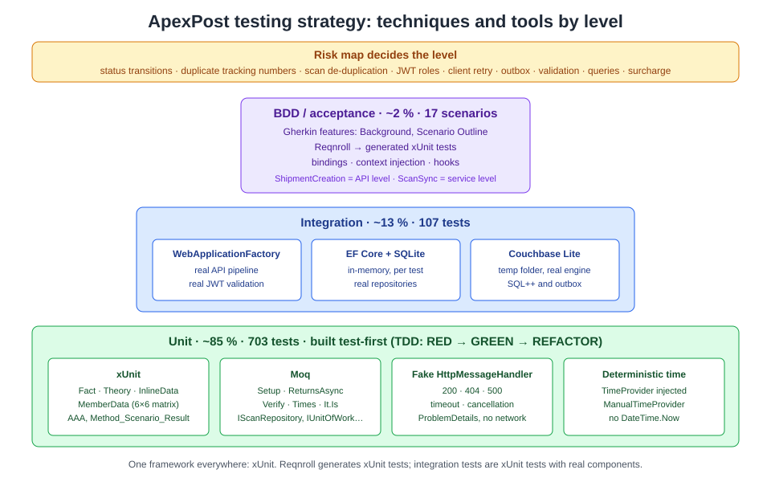

# ApexPost Testing Strategy (Week 5)

This document was written **before** the new Week 5 tests (see the first commit of branch `week5-testing`). It states what is tested, at which level, with which tools, and why. Numbers in the pyramid are a plan; the final results are in [README.md](README.md#running-the-tests) and the reflection at the end.

## 1. Risk map

Likelihood x cost of failure, highest first. Every row names the test level that guards it.

| # | Risk | Why it matters | Likelihood | Cost | Guarded by |
|---|---|---|---|---|---|
| R1 | **Shipment status transitions** (Created, PickedUp, InTransit, OutForDelivery, Delivered/Failed; no way back) | A wrong transition corrupts tracking history that customers see. | High (many branches) | High | Unit (parameterised matrix), BDD |
| R2 | **Duplicate tracking numbers** | Two parcels with one number are mis-delivered. | Medium | High | Unit (service, Moq), BDD, API integration (409) |
| R3 | **Scan de-duplication / idempotent upload** | The courier app retries uploads; a bug double-counts or loses scans. | High (retries are normal) | High | Unit (Moq `Verify`), BDD (ScanSync), integration (SQLite) |
| R4 | **JWT role rules** (Courier vs Admin, `courierId` claim) | A courier creating shipments or uploading under another id is a security hole. | Medium | Very high | Unit (policy guard), API integration (401/403/2xx with test auth) |
| R5 | **Client retry / error handling** (timeouts, 5xx, ProblemDetails, cancellation) | The field app lives on bad networks; wrong handling loses scans or hides errors. | High | High | Unit (fake `HttpMessageHandler`) |
| R6 | **Outbox state machine** (Pending to Synced / Failed, batches) | A scan stuck in Pending, or marked Synced without an upload, is silent data loss. | Medium | Very high | Unit (Moq `IShipmentUploader`), existing Couchbase tests |
| R7 | **Input validation** (tracking format, weight 0.1-70 kg, phone, future scan time, Delivered needs a signature) | Bad data enters the database. | High | Medium | Unit (`[Theory]` boundaries), BDD (Scenario Outline) |
| R8 | **Repository query correctness** (filters, paging, ordering, unique index) | LINQ that compiles can still return wrong rows. | Medium | High | Integration (real EF Core on SQLite) |
| R9 | **Heavy-parcel surcharge** (new, built with TDD) | Billing rule: a wrong threshold under- or over-charges. | Medium | Medium | Unit (TDD) |

## 2. Test pyramid

| Level | What runs there | Planned share | Actual (922 passing tests) | Speed |
|---|---|---|---|---|
| **Unit** | Domain rules, validation, services with mocked repositories, the typed HTTP client with a fake handler, the outbox with a mocked uploader | **~80 %** | **83 %** (770) | milliseconds |
| **Integration** | Real EF Core repositories on SQLite in-memory; API endpoints through `WebApplicationFactory` with a test database and test authentication; Couchbase Lite on a temp folder; MVC pipeline | **~16 %** | **13 %** (115) | tens of ms to seconds |
| **BDD / acceptance** | Reqnroll scenarios in business language, at **service level** (ScanSync) and **API level** (ShipmentCreation) | **~4 %** | **4 %** (37) | seconds |

Rationale: rules (R1, R7, R9) are pure logic, so they belong at the bottom where a failure points at one line. Wiring problems (auth, routing, serialisation, EF translation) can only be seen with real components, so they get fewer, broader tests. BDD scenarios are a thin top layer: they document what the business expects and are not a place to re-test every boundary.

### Level of each feature file

| Feature | Level | Why |
|---|---|---|
| `ShipmentCreation.feature` | **API** (in-process `WebApplicationFactory`, SQLite, test auth) | The business promise is "POST creates a shipment, a duplicate gives 409, a bad weight gives 400". Status codes, validation and the unique key only exist when the real pipeline runs. |
| `ScanSync.feature` | **Service** (`ScanUploadService` and `OutboxService` with in-memory fakes) | The promise is about counts (accepted / duplicates / rejected) and states (Pending to Synced). HTTP adds nothing here and would make the scenarios slower and more brittle. |
| `HeavyParcelSurcharge.feature` | **API** | The surcharge is a business promise about what the customer sees: it must appear in the v2 response of a real POST and a later GET, so it is checked through the real pipeline (serialisation and contract included). The arithmetic itself is covered by unit tests. || `ShipmentLifecycle.feature` | **API** | The rules are about who may change the status and which HTTP answer a forbidden move gets (204 or 409), so roles, routing and the domain rule have to run together. |

## 3. Framework choice: xUnit (one framework across the solution)

* **Consistency:** all five existing test projects already use xUnit 2.x; switching would cost rewrites with no gain.
* **Isolation:** xUnit creates a **new class instance per test**, so fields are never shared by accident. This directly supports the "no shared mutable state, no test-order dependence" constraint. NUnit reuses one instance per fixture by default.
* **Setup / teardown:** constructor plus `IDisposable` / `IAsyncLifetime` instead of `[SetUp]`/`[TearDown]`; expensive things (SQLite connection, web host) use `IClassFixture` explicitly.
* **Parameterised tests:** `[Theory]` with `[InlineData]` / `[MemberData]` covers the tracking-number, weight and transition matrices.
* **Reqnroll:** `Reqnroll.xUnit` is a first-class integration with context injection.
* **Tooling:** `Microsoft.AspNetCore.Mvc.Testing`, Moq and Test Explorer all work with xUnit without extra adapters.
* **Mocking library:** Moq 4.20.72 (the SponsorLink telemetry of 4.20.0 was removed in later 4.20.x releases; pinned above that).

No second framework is used.

## 4. Test project structure

| Project | Role | Notes |
|---|---|---|
| `tests/ApexPost.UnitTests` (**new**) | Moq-based unit tests, HTTP-handler tests, the TDD feature | No I/O, no network, no database. |
| `tests/ApexPost.IntegrationTests` (**new**) | SQLite repository tests, `WebApplicationFactory` API tests | In-memory SQLite, test JWT, no secrets. |
| `tests/ApexPost.Specs` (**new**) | Reqnroll features and bindings | Context injection, hooks. |
| `ApexPost.Domain.Tests`, `ApexPost.Application.Tests`, `ApexPost.Api.Tests`, `ApexPost.Courier.Offline.Tests`, `ApexPost.Web.IntegrationTests` (existing) | Kept as the documented equivalent of the unit/integration split for their layers | Moving ~70 files only to rename folders adds risk and no evidence of quality; the table below records each decision. |

## 5. Existing tests review

Reviewed before writing new tests. "Tests" is the number of `[Fact]`/`[Theory]` methods in the class. Nothing was deleted; where two classes overlap, the overlap is recorded rather than hidden.

| Test class (file) | Tests | Decision | Reason |
|---|---|---|---|
| `RequestValidationTests` | 5 | Kept | Parameterised DTO validation (tracking number, weight, phone, custom rule). |
| `ScanUploadServiceTests` | 9 | Kept | Covers scan de-duplication and the courierId rule with hand-written fakes. Moq-based interaction checks (Verify Times) are added in ApexPost.UnitTests. |
| `ShipmentAuthorizationTests` | 3 | Kept | Added in the Week 4 review: reflection guard that write endpoints keep [Authorize(Policy=AdminOnly)]. Complemented by a real HTTP 403 test in ApexPost.IntegrationTests. |
| `DemoDataProvisionerTests` | 4 | Kept | Seeding is deterministic and used for demos; low risk, cheap. |
| `InfrastructureDependencyInjectionTests` | 4 | Kept | Guards the composition root (wrong lifetime or missing registration fails at startup, not in a unit test). |
| `JsonAuditLogTests` | 2 | Kept | Fast file-system tests with an isolated temp directory per test; still the fallback persistence layer. |
| `JsonCounterTransactionRepositoryTests` | 4 | Kept | Fast file-system tests with an isolated temp directory per test; still the fallback persistence layer. |
| `JsonFileStoreCrudTests` | 4 | Kept | Fast file-system tests with an isolated temp directory per test; still the fallback persistence layer. |
| `JsonFileStoreDuplicateKeyTests` | 3 | Kept | Fast file-system tests with an isolated temp directory per test; still the fallback persistence layer. |
| `JsonFileStoreTests` | 7 | Kept | Fast file-system tests with an isolated temp directory per test; still the fallback persistence layer. |
| `JsonInventoryRepositoryTests` | 11 | Kept | Fast file-system tests with an isolated temp directory per test; still the fallback persistence layer. |
| `JsonMoneyOrderRepositoryTests` | 3 | Kept | Fast file-system tests with an isolated temp directory per test; still the fallback persistence layer. |
| `JsonPersistenceOptionsTests` | 7 | Kept | Fast file-system tests with an isolated temp directory per test; still the fallback persistence layer. |
| `JsonShipmentRepositoryTests` | 5 | Kept | Fast file-system tests with an isolated temp directory per test; still the fallback persistence layer. |
| `SqlPersistenceTests` | 4 | Kept (opt-in) | Real SQL Server behaviour (constraints, concurrency, migrations) that SQLite cannot prove. Skipped unless a LocalDB/SQL connection is configured, so the default run needs no setup. |
| `SqlServerIntegrationTests` | 1 | Kept (opt-in) | Real SQL Server behaviour (constraints, concurrency, migrations) that SQLite cannot prove. Skipped unless a LocalDB/SQL connection is configured, so the default run needs no setup. |
| `BranchServiceTests` | 10 | Kept | Application-service unit tests with fakes; business rules at the right level. New Moq-based interaction tests are added in ApexPost.UnitTests, not duplicated here. |
| `InventoryServiceTests` | 8 | Kept | Application-service unit tests with fakes; business rules at the right level. New Moq-based interaction tests are added in ApexPost.UnitTests, not duplicated here. |
| `MoneyOrderServiceTests` | 9 | Kept | Application-service unit tests with fakes; business rules at the right level. New Moq-based interaction tests are added in ApexPost.UnitTests, not duplicated here. |
| `SimulatedNotificationServiceTests` | 10 | Kept | Application-service unit tests with fakes; business rules at the right level. New Moq-based interaction tests are added in ApexPost.UnitTests, not duplicated here. |
| `ProductCatalogServiceTests` | 5 | Kept | Application-service unit tests with fakes; business rules at the right level. New Moq-based interaction tests are added in ApexPost.UnitTests, not duplicated here. |
| `ProductPriceRevisionServiceTests` | 3 | Kept | Application-service unit tests with fakes; business rules at the right level. New Moq-based interaction tests are added in ApexPost.UnitTests, not duplicated here. |
| `ReportingServiceTests` | 7 | Modified | Application-service unit tests with fakes; business rules at the right level. New Moq-based interaction tests are added in ApexPost.UnitTests, not duplicated here. Changed after the first CI run: it used the local clock or time zone (`DateTimeOffset.Now`, `DateTime.Today`), which made two tests fail on the UTC build server; now fixed dates and offsets. |
| `CourierStatusServiceTimeoutTests` | 2 | Kept | Application-service unit tests with fakes; business rules at the right level. New Moq-based interaction tests are added in ApexPost.UnitTests, not duplicated here. |
| `ShippingServiceTests` | 10 | Kept | Application-service unit tests with fakes; business rules at the right level. New Moq-based interaction tests are added in ApexPost.UnitTests, not duplicated here. |
| `StaffServiceTests` | 12 | Kept | Application-service unit tests with fakes; business rules at the right level. New Moq-based interaction tests are added in ApexPost.UnitTests, not duplicated here. |
| `TransactionVoidServiceTests` | 16 | Kept | Application-service unit tests with fakes; business rules at the right level. New Moq-based interaction tests are added in ApexPost.UnitTests, not duplicated here. |
| `AttributeObjectValidatorTests` | 2 | Kept | Pure validation logic, boundary cases. |
| `ScanTypeTests` | 11 | Kept | Real Couchbase Lite in a temp folder (no mocks): proves SQL++, indexes and outbox against the real engine. |
| `ShipmentScanTests` | 10 | Kept | Real Couchbase Lite in a temp folder (no mocks): proves SQL++, indexes and outbox against the real engine. |
| `SyncStatusTests` | 9 | Kept | Real Couchbase Lite in a temp folder (no mocks): proves SQL++, indexes and outbox against the real engine. |
| `CouchbaseScanRepositoryTests` | 13 | Kept | Real Couchbase Lite in a temp folder (no mocks): proves SQL++, indexes and outbox against the real engine. |
| `OutboxServiceTests` | 2 | Kept | Application-service unit tests with fakes; business rules at the right level. New Moq-based interaction tests are added in ApexPost.UnitTests, not duplicated here. |
| `BranchTests` | 6 | Kept | Domain invariants: cheapest and highest-value tests. |
| `CounterTests` | 5 | Kept | Domain invariants: cheapest and highest-value tests. |
| `CounterTransactionEntityTests` | 19 | Kept | Domain invariants: cheapest and highest-value tests. |
| `CounterTransactionTests` | 17 | Kept | Domain invariants: cheapest and highest-value tests. |
| `IdentityVerificationEntityTests` | 9 | Kept | Domain invariants: cheapest and highest-value tests. |
| `IdentityVerificationTests` | 4 | Kept | Domain invariants: cheapest and highest-value tests. |
| `InventoryStockTests` | 7 | Kept | Domain invariants: cheapest and highest-value tests. |
| `MoneyOrderEntityTests` | 16 | Kept | Domain invariants: cheapest and highest-value tests. |
| `MoneyOrderPolicyEntityTests` | 13 | Kept | Domain invariants: cheapest and highest-value tests. |
| `MoneyOrderPolicyTests` | 7 | Kept | Domain invariants: cheapest and highest-value tests. |
| `MoneyOrderTests` | 5 | Kept | Domain invariants: cheapest and highest-value tests. |
| `ProductTests` | 5 | Kept | Domain invariants: cheapest and highest-value tests. |
| `ShipmentEntityTests` | 14 | Modified | Domain invariants: cheapest and highest-value tests. Changed after the first CI run: it used the local clock or time zone (`DateTimeOffset.Now`, `DateTime.Today`), which made two tests fail on the UTC build server; now fixed dates and offsets. |
| `ShipmentTests` | 5 | Kept | Domain invariants: cheapest and highest-value tests. |
| `ShippingPricingRuleEntityTests` | 14 | Kept | Domain invariants: cheapest and highest-value tests. |
| `ShippingPricingRuleTests` | 7 | Kept | Domain invariants: cheapest and highest-value tests. |
| `StaffTests` | 6 | Kept | Domain invariants: cheapest and highest-value tests. |
| `TaxRateEntityTests` | 10 | Kept | Domain invariants: cheapest and highest-value tests. |
| `TaxRateTests` | 7 | Kept | Domain invariants: cheapest and highest-value tests. |
| `TransactionLineItemEntityTests` | 14 | Kept | Domain invariants: cheapest and highest-value tests. |
| `TransactionLineItemTests` | 7 | Kept | Domain invariants: cheapest and highest-value tests. |
| `AddressTests` | 11 | Kept | Value-object invariants (Money, Sku, Weight, BranchCode). Money/Sku/Weight exist in two files with different test names; not merged because every case is distinct and green. Merge candidate. |
| `BranchCodeTests` | 9 | Kept | Value-object invariants (Money, Sku, Weight, BranchCode). Money/Sku/Weight exist in two files with different test names; not merged because every case is distinct and green. Merge candidate. |
| `MoneyTests` | 24 | Modified | Merged with `MoneyValueObjectTests` (same class under test, every case distinct). The suite was run before and after: 330 passed both times, so no test was lost. Value-object invariants. |
| `MoneyValueObjectTests` | 12 | Replaced | File removed; its 12 tests now live in `MoneyTests` (see row above). |
| `SkuTests` | 18 | Modified | Merged with `SkuValueObjectTests` (same class under test, every case distinct). The suite was run before and after: 330 passed both times, so no test was lost. Value-object invariants. |
| `SkuValueObjectTests` | 9 | Replaced | File removed; its 9 tests now live in `SkuTests` (see row above). |
| `WeightTests` | 16 | Modified | Merged with `WeightValueObjectTests` (same class under test, every case distinct). The suite was run before and after: 330 passed both times, so no test was lost. Value-object invariants. |
| `WeightValueObjectTests` | 8 | Replaced | File removed; its 8 tests now live in `WeightTests` (see row above). |
| `SafeExceptionMiddlewareTests` | 6 | Kept | MVC web app pipeline (middleware, filters, security headers). Different host than the API, so not replaced by the new API integration tests. |
| `SqlRuntimeRegistrationTests` | 1 | Kept | MVC web app pipeline (middleware, filters, security headers). Different host than the API, so not replaced by the new API integration tests. |
| `ValidationActionFilterTests` | 3 | Kept | MVC web app pipeline (middleware, filters, security headers). Different host than the API, so not replaced by the new API integration tests. |
| `WebApplicationIntegrationTests` | 58 | Kept | MVC web app pipeline (middleware, filters, security headers). Different host than the API, so not replaced by the new API integration tests. |

## 6. Data access strategy

| Approach | Used for | What it **proves** | What it does **not** prove |
|---|---|---|---|
| **Mocked repository** (`Mock<IShipmentRepository>`) | Service logic: "if it exists then 409", "save is called once", "nothing is saved on failure" | The service decides and sequences correctly given what the repository says | That the real query or unique index behaves that way; that the mock's `Returns` matches the real repository (a wrong setup passes happily) |
| **SQLite in-memory** (real EF Core provider) | Repository queries, paging, filtering, ordering, uniqueness, change tracking | That LINQ translates to SQL and returns the right rows through the real `DbContext` | SQL Server specifics: `rowversion`, `datetime2`, collations, server-side defaults, locking, retry-on-failure, migrations. String comparison and case-sensitivity differ. |
| **SQL Server / LocalDB** (existing opt-in tests, plus `SqlServerTrackedShipmentTests` for the unique tracking number and `UniqueKeyConflictException` mapping) | Migrations, concurrency tokens, constraints, the real unique index | Behaviour on the production provider | Needs a SQL instance; slower; skipped by default so `dotnet test` works with no setup |
| **Couchbase Lite temp folder** (existing) | SQL++ queries, indexes, outbox | Real embedded-engine behaviour | Sync Gateway behaviour (out of scope) |

**Why `DbContext`/`DbSet` are not mocked for query logic:** a mocked `DbSet` runs LINQ-to-Objects, not LINQ-to-SQL. Queries that cannot be translated, that sort strings differently, that forget an `Include`, or that rely on a unique index all *pass* against a mock and *fail* in production. The test would only prove that C# can filter a list. Mocking `IQueryable` also couples the test to the exact call shape, so harmless refactors break it. A real (even if different) database provider is the smallest honest substitute.

## 7. What is not tested, and why

* **MAUI / UI / browser / navigation:** explicitly out of scope; the courier client is a console app anyway.
* **Third-party internals** (EF Core, Polly, Couchbase Lite, ASP.NET Core): we test our use of them, not their code.
* **Generated code** (`ApexPost.Client.cs` from NSwag, EF migration designer files): regenerated from the contracts, which are the source of truth.
* **Real network, e-mail, production databases:** forbidden by the constraints; HTTP is faked at the `HttpMessageHandler`.
* **Performance and load:** a different kind of test with different tooling; SQL performance plans live in `docs/performance-plans`.
* **Trivial members** (auto-properties, DTO getters): no logic, no risk.
* **Code coverage as a goal:** coverage is reported only as evidence of where we are blind.

## 8. Rules every new test follows

* AAA with `// Arrange`, `// Act`, `// Assert` comments; names are `Method_Scenario_ExpectedResult`.
* Deterministic: time comes from `FakeTimeProvider` or fixed `DateTimeOffset` values, never `DateTime.Now`; every test builds its own data; SQLite databases are per test; no static state.
* Fictional data only (`APX-20250101`, `COURIER-001`, `Jane Example`, `+15550100`).
* No secrets: the test JWT key is a clearly fake constant used only by the in-memory test host; no connection strings.
* Run everything with `dotnet test ApexPost.sln` (no manual setup).

## 9. Reflection

**What did the strategy catch?**

* Two real defects in `TrackedShipment.Create`, found by the boundary tests before any BDD existed: weights from 0.01 to 0.09 kg were accepted although the rule says 0.1 kg, and a tracking number ending in a newline passed the `$` anchored regex. Both fixed (commit `e3d23eb`).
* A testability gap: `ScanUploadService` read the system clock, so the "5 minutes in the future" boundary could not be tested exactly. An optional `TimeProvider` fixed it without changing callers.
* A mismatch worth knowing about, found while writing the API tests: the status DTO demands a reason for `Delivered`, the domain does not.
* Deliberate breakage (COPILOT-LOG.md) showed that the important rules are guarded at two levels at once: disabling the duplicate-scan check fails 3 Moq tests and 2 BDD scenarios.

**What would I change?**

* The overlapping Domain test classes (Money, Sku, Weight) were merged in the completion round: 330 tests before and after, none lost (section 5).
* Run the SQL Server tests in CI against a container (they pass locally on LocalDB: 949 passed, 0 skipped), so they are not only a local opt-in.
* Coverage reporting was added in the completion round (section 12); the next step is a threshold-free trend in CI.
* Move the SQLite customizer's knowledge (which SQL Server details are removed) into a short test that fails if a new SQL Server only mapping appears, instead of discovering it when schema creation breaks.
* The DTO regex for the tracking number still uses `$`; the domain now rejects the trailing newline (HTTP 400), but the contract and generated client keep the old pattern. Changing it needs a contract re-export.

**Which test type gave the most confidence per minute?**

Parameterised unit tests with Moq. Each took a minute or two to write, ran in milliseconds and pointed at one line when they failed (the 6 x 6 transition matrix is 36 cases from one method). The API tests through `WebApplicationFactory` gave the most confidence **per test** (JWT validation, role policy, routing, validation, the exception handler and EF Core in one request), but cost the most setup time: making the SQL Server model run on SQLite took longer than all the endpoint tests together. BDD scenarios gave the least extra bug-finding but the best communication: a non-programmer can read `ScanSync.feature` and check that the rules are the agreed ones.

**Honest limits**

SQLite is not SQL Server (section 6), the Moq tests only prove sequencing, and the Copilot step needs to be repeated with Copilot itself (COPILOT-LOG.md explains why this log does not claim it).

## 10. Diagrams

How TDD, BDD, xUnit, Moq and Reqnroll combine (one framework, several techniques). The full set (overview, TDD cycle, BDD flow, data-access decisions) is in [docs/TESTING-DIAGRAMS.md](docs/TESTING-DIAGRAMS.md); the overview as a picture:

* **xUnit** is the single test framework and runner; **Reqnroll** only generates xUnit tests from Gherkin, so Test Explorer and `dotnet test` see everything.
* **Moq** and the fake `HttpMessageHandler` isolate dependencies at the unit level. Mocks are `MockBehavior.Strict` where "nothing may be saved" matters, so an unexpected call fails the test by itself.
* **TDD** is how unit-level rules are written (RED, GREEN, REFACTOR commits); **BDD** is how business behaviour is agreed and checked at API or service level.

## 11. Completion round (what was added after the first review)

* **TDD cycle 3:** the surcharge rule is now wired into the product: `TrackedShipment.Surcharge` and the additive v2 field `surchargeAmount` (RED, GREEN, REFACTOR commits; [TDD-LOG.md](TDD-LOG.md) section 9). The v2 contract was re-exported and the client regenerated; v1 is unchanged.
* **BDD:** two more features at API level (`HeavyParcelSurcharge`, `ShipmentLifecycle`), 33 scenarios in total, all four features with a Background and a Scenario Outline.
* **Mocking:** `ShipmentApiServiceMoqTests` covers duplicate tracking numbers (R2) and the status and delete rules with strict mocks; `SqliteModelGuardTests` makes the limits of the SQLite substitute explicit so they cannot drift unnoticed.
* **Mutation proof 4:** changing the 30 kg threshold fails a unit, an integration and a BDD test (`docs/evidence/mutation-4-surcharge-threshold.txt`).

## 12. Coverage: evidence, not a target

Measured with `coverlet` over the default run (no SQL Server), generated code, EF migrations and the NSwag client excluded, results of all test projects merged by a small script (line coverage; the figures are indicative, not exact):

| Assembly | Lines covered | Lines | Line coverage |
|---|---:|---:|---:|
| ApexPost.Api | 1310 | 3304 | 39.6 % |
| ApexPost.Application | 1872 | 3678 | 50.9 % |
| ApexPost.Courier.Console | 69 | 1264 | 5.5 % |
| ApexPost.Courier.Domain | 48 | 48 | 100.0 % |
| ApexPost.Courier.Offline | 214 | 494 | 43.3 % |
| ApexPost.Domain | 1964 | 2829 | 69.4 % |
| ApexPost.Infrastructure | 2375 | 5384 | 44.1 % |
| ApexPost.Web | 1323 | 2294 | 57.7 % |
| **All listed assemblies** | **9175** | **19295** | **47.6 %** |

**Where the suite is blind (and why that is acceptable or planned):**

* **`ApexPost.Courier.Console` (about 6 %):** only `ApexApiClient` and its models are tested. The menus, token storage (DPAPI), connectivity monitor and Polly pipeline setup are console and platform glue; their behaviour is shown by the Week 4 runtime evidence, not by unit tests. This is the largest honest gap.
* **`ApexPost.Api` (about 40 %):** services and the pipeline are covered through `WebApplicationFactory`; the OpenAPI document transformers, Swagger setup and the Development-only token endpoint are not (they are Development tooling).
* **Infrastructure (about 44 %) and Web controllers:** SQL Server specific paths (retry-on-failure, stored procedures, migrations) are only exercised when the opt-in SQL Server tests run; with `APEXPOST_SQL_TEST_CONNECTION` set, 949 tests pass with nothing skipped (`docs/evidence/test-run-with-sqlserver.txt`), which these default-run figures do not include.
* **Domain (about 69 %):** the highest-risk rules (status machine, weight, tracking number, surcharge) are covered by name in the risk map; what is uncovered is mostly entities of the Week 2/3 counter workflows that this lab did not target.

Coverage tells us where tests are missing; it does not tell us the tests are good (the deliberate-breakage proofs in COPILOT-LOG.md do that). No coverage number was used as a goal.

## 13. What the first CI run caught

The new GitHub Actions run (UTC build server) failed two Domain tests that pass on a developer machine: `Constructor_NonUtcCreatedAtUtc_ShouldReject` and `RecordCourierStatus_NonUtcTimestamp_ShouldReject` built their "non-UTC" value from `DateTimeOffset.Now`, which has offset zero on a UTC machine, so no exception was thrown. This is exactly the determinism rule of the lab (no reliance on the clock or machine settings). Both now use a fixed `+05:30` offset, and `ReportingServiceTests` no longer uses `DateTime.Today`. Lesson: a local green run is not proof of determinism; a second environment is.
