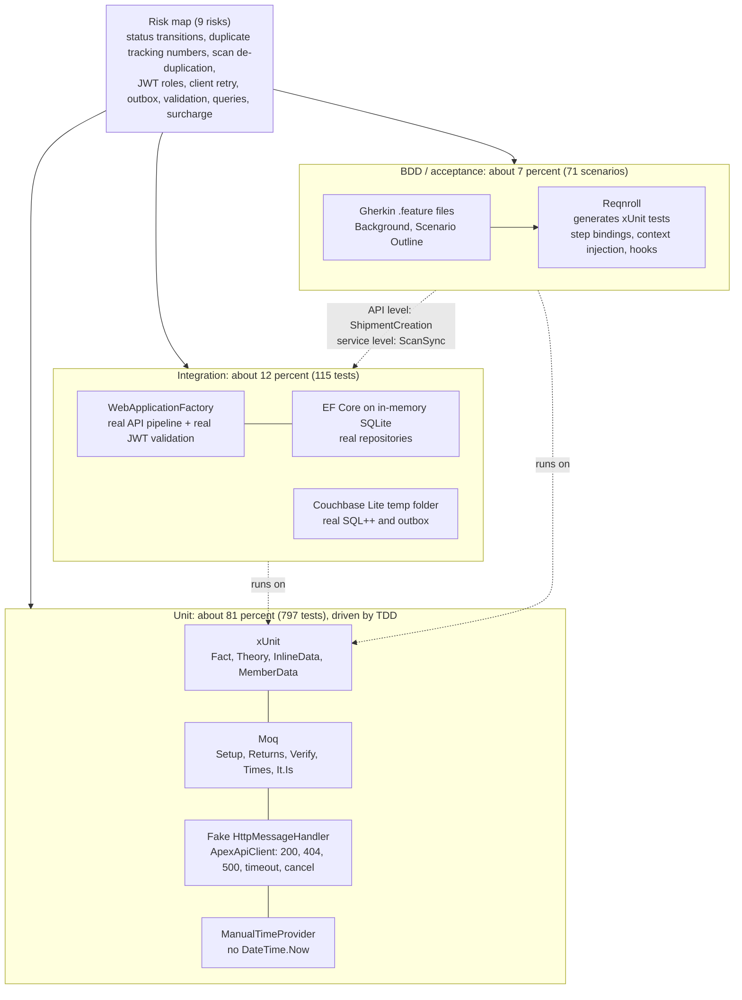
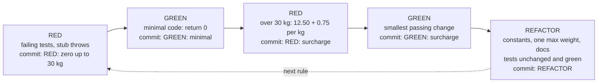
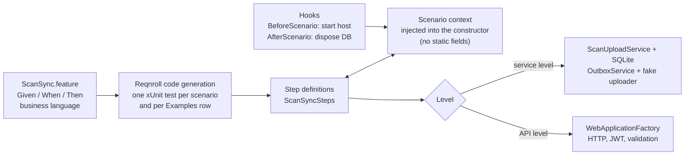
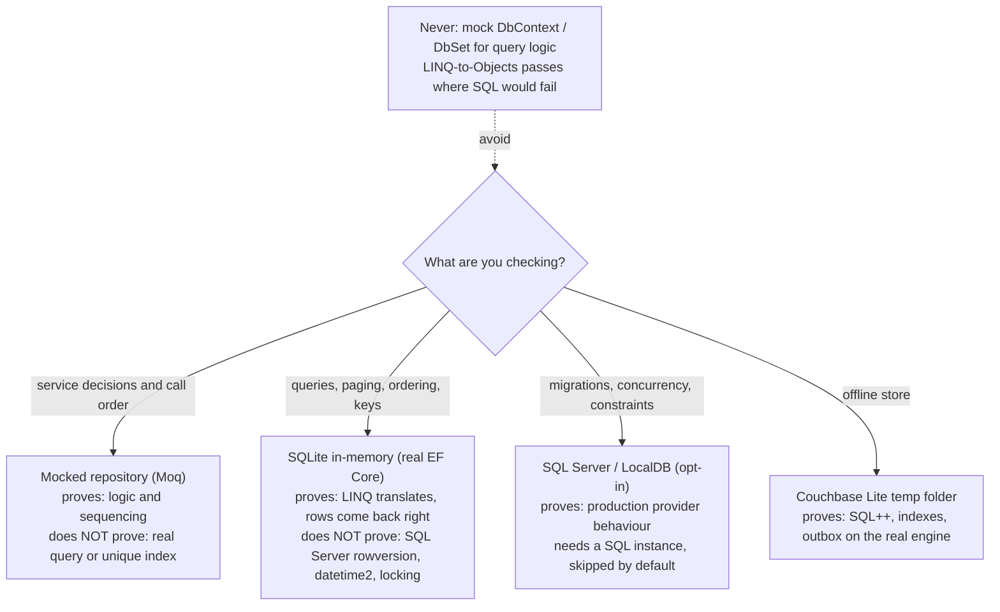

# ApexPost testing diagrams

How the testing techniques and tools fit together. The diagrams are Mermaid, so GitHub renders them. A standalone picture of the overview is in [testing-strategy-diagram.svg](testing-strategy-diagram.svg).

## 1. Strategy overview: which technique and tool at which level

## 2. TDD cycle (task 4, heavy parcel surcharge)

## 3. BDD flow with Reqnroll

## 4. Which data access approach proves what

