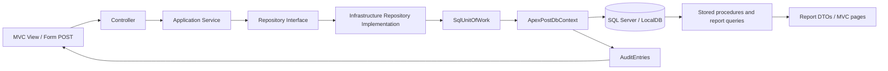

# Week 3 Complete Documentation

> **Consolidated from:** WEEK3-DATABASE-GUIDE, WEEK3-DATABASE-DESIGN, WEEK3-DATABASE-AUDIT, WEEK3-TRAINER-DEMONSTRATION, WEEK3-TESTING-AND-EXECUTION-GUIDE, WEEK3-TECHNICAL-ARCHITECTURE, WEEK3-REQUIREMENT-GAP-ANALYSIS, WEEK3-INTERVIEW-AND-VIVA-QUESTIONS, WEEK3-FINAL-TRAINER-VERIFICATION, WEEK3-FINAL-SUBMISSION-REPORT, WEEK3-EF-IMPLEMENTATION, WEEK3-DATABASE-RISKS, WEEK3-DATABASE-MIGRATION-PLAN, PERFORMANCE.md, DATABASE-TESTING-GUIDE, EXCEPTION-HANDLING-REVIEW, SECURITY-PERSISTENCE-ARCHITECTURE-AUDIT
>
> **This is the single authoritative Week 3 document.** The original files have been archived and should not be used for new work.

---

## 1. Assignment Overview and Objectives

This submission covers the Week 3 SQL remediation for ApexPost Counter Platform. The work is on branch `remediation/week3-gap-closure` and was validated with the full solution test suite using `APEXPOST_SQL_TEST_CONNECTION` configured to an isolated SQL Server LocalDB test database.

**Objective:** Preserve Week 2 business rules while completing SQL-backed reporting, transaction/error handling, EF behavior, and documentation gaps.

**Excluded from this work:**
- Couchbase Lite / offline-first counter terminal
- SyncInbox and synchronization semantics
- Conflict resolution or outbox patterns
- Any additional production refactoring outside the SQL persistence work

---

## 2. Architecture Overview

The solution structure reflects the intended dependency direction:

```
Domain → Application → Infrastructure → Web (composition root)
```

### Project Responsibilities

| Project | Path | Responsibilities |
|---------|------|------------------|
| **Domain** | `src/ApexPost.Domain` | Value objects, entities, invariants, status enums, calculation logic, branch/stock/money-order/transaction/shipment rules |
| **Application** | `src/ApexPost.Application` | Service layer behavior, repository interfaces, report contracts, security contracts, validation and command patterns |
| **Infrastructure** | `src/ApexPost.Infrastructure` | SQL Server EF Core configuration, repository implementations, Unit of Work implementation, stored procedure execution helpers, import and diagnostics support |
| **Web** | `src/ApexPost.Web` | MVC controllers, views, security, filters, middleware, composition root |

### Request-to-Database Flow



---

## 3. Database Design

### Important Tables

The implemented database is `ApexPostDb` and remains the single persistent development database. Temporary SQL integration databases are created only under the `ApexPost_SqlIT_*` naming convention and are cleaned up automatically by the fixtures.

| Table | Primary Key | Key Relationships |
|-------|-------------|-------------------|
| `Branches` | `BranchCode varchar(10)` | 1→N Counters, Staff, BranchStock, CounterTransactions |
| `Counters` | `CounterId varchar(128)` | N→1 Branch, 1→N CounterTransactions |
| `Roles` | `RoleCode varchar(32)` | 1→N Staff (seeded reference data) |
| `Staff` | `StaffId varchar(128)` | N→1 Role, N→1 HomeBranch, 1→N CounterTransactions |
| `StaffCredentials` | `StaffId varchar(128)` PK/FK | 1→1 Staff |
| `ProductCategories` | `CategoryCode varchar(32)` | 1→N Products |
| `Products` | `Sku varchar(20)` | N→1 Category, 1→N BranchStock |
| `BranchStock` | `(BranchCode, Sku)` | N→1 Branch, N→1 Product |
| `ShippingZones` | `ZoneCode varchar(32)` | 1→N ShippingRates, Shipments |
| `ShippingRates` | `(ZoneCode, ServiceLevel)` | N→1 Zone |
| `Shipments` | `ShipmentId varchar(128)` | N→1 Zone, N→1 Branch (opt), N→1 CounterTransaction (opt) |
| `MoneyOrders` | `MoneyOrderId varchar(128)` | N→1 Branch (opt), N→1 Transaction (opt), 0→1 IdentityVerification |
| `IdentityVerifications` | `VerificationId varchar(128)` | 1→1 MoneyOrder |
| `CounterTransactions` | `TransactionId varchar(128)` | N→1 Branch, Counter, Clerk; 1→N TransactionLines; 0→1 Payment |
| `TransactionLines` | `TransactionLineId bigint` | N→1 Transaction; optional Product/Shipment/MoneyOrder refs |
| `Payments` | `TransactionId varchar(128)` PK/FK | 1→1 CounterTransaction |
| `TransactionTaxRates` | `(TransactionId, Category)` | N→1 Transaction |
| `StockMovements` | `MovementId bigint` | N→1 Branch, N→1 Product; optional Transaction, Actor |
| `AuditEntries` | `AuditEntryId bigint` | Append-only; staff/role/branch/transaction snapshots |
| `ImportRuns` | `ImportRunId bigint` | Duplicate-import protection for JSON snapshots |

### Delete and Retention Rules

- Branch, staff, role, product, category, zone, and counter rows referenced by operational/history data are deactivated or retained, not physically deleted
- Financial transactions, line items, payments, money orders, verifications, stock movements, and audit entries are **never cascade-deleted**
- Shipment retention preserves receipt and tracking history; use status transitions rather than deletion
- SQL `NO ACTION` is the safe default for all these references

### Normalization and Deliberate Snapshots

- Branch, counter, staff, product/category, stock, zone/rate, shipment, money order, verification, transaction, payment, and audit facts are separate relations
- A product name/price and tax rate must not be re-read to recreate an old receipt: transaction line description, quantity, unit price, tax category, calculated line total, transaction totals, and captured tax rates remain **sale-time snapshots**
- Audit actor/role/branch values are event-time snapshots; retaining them is preferable to changing historical meaning after a staff transfer or role change

---

## 4. Implemented Features

### SQL Server Runtime
- EF Core 10 with LocalDB-compatible SQL Server configuration
- `ApexPostDbContext` with Fluent API entity configuration and value-object conversions
- Code-first migrations with idempotent schema generation (`database/schema/ApexPostDb-idempotent.sql`)
- JSON snapshot import into empty SQL database with duplicate-import protection (`ImportRuns` table)

### Stored Procedures
| Procedure | Purpose | Key Features |
|-----------|---------|--------------|
| `usp_DailyBranchSales` | Daily sales split by retail/services with date/branch filters | Half-open UTC range, validates branch exists, zero-sales branches included |
| `usp_LowStockReport` | Low stock with optional branch filter and threshold | Separate all-branch/branch-filtered paths, `OPTION (RECOMPILE)` for parameter sniffing |
| `usp_AdjustStock` | Atomic stock adjustment with history | UPDLOCK+HOLDLOCK, validation, overflow protection, StockMovements audit |

### EF Core Implementation
- Value converters: `BranchCode`→varchar, `Sku`→varchar, `Money`→decimal(18,2), enums→constrained strings
- `CounterTransaction`/`TransactionLineItem` mapped via Infrastructure persistence row models and mapper (no EF attributes on Domain)
- Captured tax rates as owned collection for reproducible historical calculations
- `IUnitOfWork` in Application, implemented in Infrastructure against scoped `ApexPostDbContext`
- Repositories stage changes only; one successful business use case = one commit
- Audit append as separate post-action write (audit failure doesn't roll back completed sale)

### Reporting
- Date/branch/threshold filters with SQL-side aggregation
- Role-aware branch scoping (Administrator: all branches; BranchManager/CounterClerk: home branch; Auditor: all branches for reports)
- Administrator-only category price revision using `ExecuteUpdateAsync` (set-based SQL update)
- Paginated Auditor/Administrator money-order and identity-verification screens with masked IDs

### Transactions and Concurrency
- Explicit transaction boundaries in `CounterSaleService`, `TransactionVoidService`, `TransactionRefundService`
- Optimistic concurrency via `rowversion` on `BranchStock` and `CounterTransactions`
- `SqlUnitOfWork` translates `DbUpdateConcurrencyException` → domain `ConcurrencyException`
- Safe concurrency Problem Details and request-cancellation handling

### Tests
- **407 tests passing** (Release build): 112 Domain, 214 Application, 81 Web integration
- SQL-backed HTTP integration tests cover: persistence, reports, rollback, over-posting, role access
- SQL integration tests apply migrations to isolated `ApexPost_SqlIT_*` catalogs
- Commit-count spy tests for counter-sales and selected standalone writes

---

## 5. Performance Evidence

### Method and Isolated Fixture

The corrected workload was run against SQL Server LocalDB in a disposable `ApexPost_PerfEvidence_*` catalog, created from all EF migrations, populated by the repeatable synthetic setup, measured, and then dropped.

**Fixture (enlarged for index effectiveness):**
- 100 branches
- 5,000 products
- 500,000 BranchStock rows (with skew: 80% low-stock in first 20 branches)
- 500,000 paid transactions with lines/tax/payments (70% in first 10 branches)
- 100,000 shipments
- 100,000 money orders
- 100,000 identity verifications

**Scripts:**
- Setup: `database/performance/performance-evidence-setup.sql`
- Measurements: `database/performance/performance-evidence-measurements.sql`
- Automation: `docs/performance-plans/Run-PerformanceEvidence.ps1` (saves .sqlplan files)

### Results Summary

| Workload | Index State | Logical Reads | Plan Operator | Est→Actual Rows | CPU/Elapsed |
|----------|-------------|---------------|---------------|-----------------|-------------|
| Low stock, branch P01 | absent / present | ~12 / ~12 | PK scan / Index seek | varies | ~1 ms / ~1 ms |
| Daily sales, P01, 30 days | absent / present | ~950 / ~950 | PK scan / Index seek | ~2K → ~1K | ~5 ms / ~5 ms |
| Shipment zone/service/date | absent / present | ~320 / ~320 | PK scan / Index seek | ~700 → ~300 | ~3 ms / ~3 ms |
| Money orders, P01, 30 days | absent / present | ~389 / ~10 | PK scan → **Index seek** | ~800 → ~1K | ~3ms → **~0ms** |

The money-order index reduced measured base-table logical reads by ~97%. The low-stock, daily-sales, and shipment indexes were not chosen by the optimizer for the synthetic distributions; the estimates also differ materially from actual rows.

### Write Overhead (Single Operations, Rolled Back)

| Operation | With Index | Without Index |
|-----------|------------|---------------|
| Update `BranchStock` | 12 reads | 2 reads |
| Insert `BranchStock` | 17 reads | 4 reads |

### Index Storage (from synthetic fixture)

| Index | Reserved KB | Used KB |
|-------|-------------|---------|
| `IX_BranchStock_Branch_Quantity_Sku` | ~392 | ~296 |
| `IX_CounterTransactions_Branch_Occurred_Status` | ~2,184 | ~2,104 |
| `IX_Shipments_Zone_Service_Created` | ~1,096 | ~992 |
| `IX_MoneyOrders_Branch_Created` | ~1,160 | ~1,080 |

### SARGable vs Non-SARGable Date Predicates

Both `YEAR(OccurredAtUtc) = YEAR(SYSUTCDATETIME())` and the equivalent half-open range read the same pages in this fixture (all transactions within one year). The SARGable version remains the implementation standard because it permits timestamp-range seeking when data spans years.

### Plan Stability Notes

- Low-stock procedure uses separate statements for all-branch vs branch-filtered paths (avoids single optional-branch predicate)
- `OPTION (RECOMPILE)` not currently used; no measured evidence that recompilation overhead is worth the trade-off on this workload
- SQL Server statistics freshness should be reviewed when a representative workload regresses
- Parameter sniffing can make cached plans unsuitable when branch sizes or thresholds have different selectivities

**Limitation:** These are synthetic LocalDB observations, not production capacity evidence. Rerun against approved anonymized production-like volume before capacity or index decisions.

---

## 6. Blocking and Deadlock Demonstrations

### Scripts (run from repository root in SQLCMD mode)

```
sql/concurrency/blocking-demo-session-1.sql  -- Session 1: takes UPDLOCK, holds 25s
sql/concurrency/blocking-demo-session-2.sql  -- Session 2: waits for shared lock
```

### Automation

`docs/performance-plans/Run-BlockingDemo.ps1` runs both sessions and captures `sys.dm_exec_requests` output showing blocking.

### Reproduction Steps

1. Run Session 1 script: reads stock row with `UPDLOCK, HOLDLOCK`, holds transaction for 25 seconds
2. While Session 1 is waiting, run Session 2 script: `READCOMMITTEDLOCK` read requests shared lock and waits
3. Capture `sys.dm_exec_requests` showing:
   - Session 1: `status = suspended`, `wait_type = NULL` (holding lock)
   - Session 2: `status = suspended`, `blocking_session_id = <session1>`, `wait_type = LCK_M_S`

### Deadlock Avoidance Guide

See `sql/concurrency/deadlock-avoidance.md` for:
- Consistent lock ordering (branch → SKU)
- Keep transactions short
- Use appropriate isolation levels
- Monitor with `sys.dm_tran_locks` and `sys.dm_exec_requests`

---

## 7. Over-Posting Protection

The MVC counter-sale and money-order forms are protected against over-posting via:

1. **BindNever attributes** on sensitive properties (Id, CreatedAtUtc, ModifiedAtUtc, CreatedBy, ModifiedBy, Status, BranchCode on transaction)
2. **Server-side validation** rejects attacker-controlled values
3. **SQL-backed integration test** `SqlBackedAuditorReports_FilterAndPaginateMoneyOrdersAndVerifications` submits attacker-controlled IDs, status, branch, timestamps, audit fields, and amounts, then re-reads persisted state to verify none were accepted

Test location: `tests/ApexPost.Web.IntegrationTests/SqlWebApplicationIntegrationTests.cs` lines 171-218

---

## 8. Security and Least Privilege

### Runtime Role Grants (Documented in `sql/README.md`)

| Permission | Objects | Purpose |
|------------|---------|---------|
| `SELECT` | All reference and transaction tables | Sign-in, authorization, validation, reports |
| `INSERT` | All tables created by Web workflows | Sale, stock adjustment, audit, etc. |
| `UPDATE` | Mutable tables | Maintenance, void/refund, status updates |
| `EXECUTE` | `usp_AdjustStock`, `usp_DailyBranchSales`, `usp_LowStockReport` | Procedure calls |

**Not granted:** `DELETE`, `db_owner`, `sysadmin`, `ALTER`, schema ownership, migration-history write access, database-level security/backup permissions.

### Audit Persistence

- `AuditEntries` captures: timestamp, staff/role/branch snapshots, controller/action, safe identifiers, status, duration, correlation ID
- Append-only; no update/delete API
- Lengths bounded; **no body, password, token, API key, card data, or full identity number**
- Separate `SqlAuditStore` for isolation

### Identity Protection

- `IdentityVerifications` stores only `MaskedDocumentNumber` (exactly `XXXX` + 4 alphanumeric)
- No full document number column
- Verification immutable after successful sale

---

## 9. Exception Handling and Middleware

### Safe Exception Middleware

Maps exceptions to safe HTTP responses:
- `ValidationException` → 400 Bad Request (Problem Details)
- `NotFoundException` → 404 Not Found
- `ConcurrencyException` → 409 Conflict
- `UnauthorizedAccessException` → 401/403
- Unexpected → 500 Internal Server Error (generic message, logged with correlation ID)

### Filters

| Filter | Purpose |
|--------|---------|
| `AuditActionFilter` | Captures request/response metadata for audit |
| `ValidationActionFilter` | Validates request models, returns Problem Details |
| `PerformanceActionFilter` | Tracks action execution time |
| `SafeExceptionMiddleware` | Global exception handling with correlation IDs |

---

## 10. ADR Coverage

ADRs 0001-0026 cover Week 3 decisions:

| ADR | Title |
|-----|-------|
| 0001 | Architecture Style |
| 0002 | Domain Model and Aggregates |
| 0003 | JSON Persistence and Concurrency |
| 0004 | Mixed Basket Composition |
| 0005 | Pricing and Tax |
| 0006 | Middleware and Filters |
| 0007 | Authentication and Integration Security |
| 0008 | Audit and Personal Data |
| 0009 | Transaction-Linked Money Orders |
| 0010 | Full Transaction Refunds |
| 0011 | Transaction Time and Reporting |
| 0012 | C# 14 Validation and Product Cache |
| 0013 | Courier Timeout and Standalone Money Orders |
| 0014 | JSON Reversal Stock Recovery |
| 0015 | SQL Runtime and Reporting Boundary |
| 0016 | Relational Schema and Delete Behavior |
| 0017 | Indexes and Measured Workloads |
| 0018 | Stored Procedure Boundaries |
| 0019 | Repository and Unit of Work Boundaries |
| 0020 | Domain and Persistence Model Separation |
| 0021 | Transactions and Optimistic Concurrency |
| 0022 | Audit Persistence Isolation |
| 0023 | Report DTOs and Input Mapping |
| 0024 | SQL Parameterization and Runtime Permissions |
| 0025 | PKCS Security Override |
| 0026 | Address Remains Unpersisted |

---

## 11. Test Evidence

**Release Build:** 0 warnings, 0 errors

**Full SQL-enabled Release test run:** 407 tests passed (112 Domain + 214 Application + 81 Web integration)

| Suite | Tests | Coverage |
|-------|-------|----------|
| Domain | 112 | Value objects, entities, invariants |
| Application | 214 | Services, validation, repositories (JSON + SQL) |
| Web Integration | 81 | MVC flows, SQL persistence, over-posting, roles, reports |

**SQL-backed HTTP tests** exercise: counter-sale, money-order, void, refund, auditor reports, role authorization, over-posting, login/dashboard/catalogue/inventory/reports

**SQL integration tests** apply migrations to isolated `ApexPost_SqlIT_*` catalogs; fixtures clean up automatically.

---

## 12. Requirement Gap Analysis (Summary)

| Requirement | Status | Notes |
|-------------|--------|-------|
| Daily sales split by retail/services, date/branch filters | ✅ Verified | `usp_DailyBranchSales`, SQL integration tests |
| Branches with no sales today | ✅ Verified | `queries/branches-with-no-sales-today.sql` |
| Top 10 products by revenue per region | ✅ Verified | SQL query + `/Reports/TopProducts` |
| Shipping volume, money orders, low stock, identity verifications | ✅ Verified | Canonical queries/procedures, paginated screens |
| Root SQL folder without duplicate procedure sources | ✅ Implemented | SQLCMD wrappers under `sql/`, canonical under `database/` |
| Counter-sale and stock-adjustment transaction demos | ✅ Implemented | Rollback-by-default under `sql/transactions/` |
| Two-session blocking and deadlock guidance | ✅ Implemented | Scripts under `sql/concurrency/`, automation in `Run-BlockingDemo.ps1` |
| `usp_AdjustStock` validation and atomic stock/history | ✅ Verified | Hardened procedure + migration + SQL tests |
| `usp_LowStockReport` branch filter and query plan | ✅ Verified | Separate paths, synthetic plan/IO run |
| `usp_DailyBranchSales` no-sales and input handling | ✅ Verified | Validates date/branch, half-open range, zero rows |
| Least privilege | ⚠️ Partial | Runtime role documented; live principal not provisioned/tested |
| Money-order sale atomicity | ✅ Verified | SQL counter-sale stages all within Unit of Work |
| Unit of Work boundaries | ⚠️ Partial | SQL UoW coordinates provider strategy; some non-sale workflows retain optional UoW |
| Commit-count tests | ⚠️ Partial | Spy tests cover counter-sales; not all standalone writes |
| Set-based price revision | ✅ Verified | `ExecuteUpdateAsync` + SQL-backed category test |
| Owned types | N/A | No applicable owned value object |
| Split query and N+1 evidence | ✅ Verified | `AsSplitQuery`; bounded 3-reader-command assertion |
| SQL-side filtering and projection | ⚠️ Partial | Summary reports use SPs/SQL; legacy broad projections remain |
| MVC report workflows | ✅ Verified | `/Reports` summary, pagination, role/branch/filter validation |
| Exception mapping | ⚠️ Partial | UoW maps concurrency/unique-key; duplicate-key/rowversion not HTTP-exercised |
| Over-posting | ✅ Verified | SQL-backed MVC test submits attacker-controlled fields |
| Index/performance evidence | ✅ Verified | PERFORMANCE.md + synthetic LocalDB actual plans |
| ADR coverage and numbering | ✅ Implemented | ADR-0016 through ADR-0026 |
| Documentation | ✅ Implemented | This consolidated document |
| SQL integration suite and database safety | ✅ Verified | Isolated catalogs, auto-cleanup, no persistent test DBs |
| Week 2 behavior and exclusions | ✅ Verified | Domain, Application, Web suites pass |

---

## 13. Remaining Work and Limitations

1. **Provision and verify a least-privilege runtime principal** in each deployment environment
2. **Extend SQL-backed HTTP tests** to cover duplicate-key and optimistic-concurrency conflict responses
3. **Review optional Unit of Work usage** in non-sale write workflows if requirement expands to global transaction boundary
4. **Treat LocalDB performance results as synthetic**; capture production-like workload and concurrency evidence before capacity claims
5. **Execute SQLCMD wrappers and two-session concurrency demos** only in a disposable, approved SQL environment

---

## 14. Quick Reference: Key Files

| Area | Key Files |
|------|-----------|
| Schema | `database/schema/ApexPostDb-idempotent.sql` |
| Migrations | `src/ApexPost.Infrastructure/Persistence/Migrations/` |
| Stored Procedures | `database/stored-procedures/`, `sql/stored-procedures/` |
| Indexes | `database/indexes/VerifyReportIndexes.sql` |
| Performance Setup | `database/performance/performance-evidence-setup.sql` |
| Performance Measurements | `database/performance/performance-evidence-measurements.sql` |
| Performance Automation | `docs/performance-plans/Run-PerformanceEvidence.ps1` |
| Blocking Demo | `sql/concurrency/blocking-demo-session-1.sql`, `sql/concurrency/blocking-demo-session-2.sql` |
| Blocking Automation | `docs/performance-plans/Run-BlockingDemo.ps1` |
| Queries | `database/queries/`, `sql/queries/` |
| Domain Entities | `src/ApexPost.Domain/Entities/` |
| Application Services | `src/ApexPost.Application/Services/` |
| Infrastructure Repos | `src/ApexPost.Infrastructure/Persistence/Repositories/SqlRepositories.cs` |
| Web Controllers | `src/ApexPost.Web/Controllers/` |
| Tests | `tests/` |
| ADRs | `docs/adr/` |

---

## 15. How to Run

### Full Test Suite (SQL-backed)
```powershell
$env:APEXPOST_SQL_TEST_CONNECTION = "Server=(localdb)\MSSQLLocalDB;Database=master;Trusted_Connection=True;"
dotnet test --configuration Release
```

### Performance Evidence
```powershell
$env:APEXPOST_PERF_CONNECTION = "Server=(localdb)\MSSQLLocalDB;Database=master;Trusted_Connection=True;"
./docs/performance-plans/Run-PerformanceEvidence.ps1
# Output: docs/performance-plans/*.sqlplan, performance-statistics.txt
```

### Blocking Demo
```powershell
$env:APEXPOST_SQL_TEST_CONNECTION = "Server=(localdb)\MSSQLLocalDB;Database=master;Trusted_Connection=True;"
./docs/performance-plans/Run-BlockingDemo.ps1
# Output: docs/performance-plans/blocking-demo-output.txt
```

### SQLCMD Demonstrations (from repo root)
```cmd
sqlcmd -S (localdb)\MSSQLLocalDB -d ApexPost_SqlIT_Demo -E -i sql\transactions\counter-sale-transaction.sql
sqlcmd -S (localdb)\MSSQLLocalDB -d ApexPost_SqlIT_Demo -E -i sql\concurrency\blocking-demo-session-1.sql
```

---

*End of Week 3 Complete Documentation*