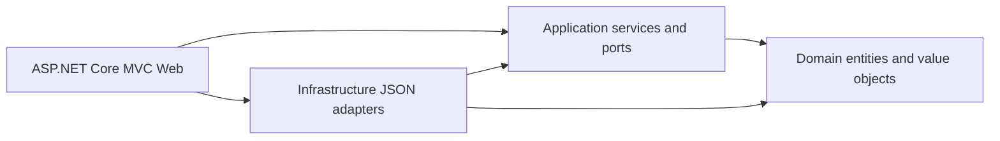

# Week 3 Phase 1: Existing Project Audit

**Status:** historical Phase 1 design and discovery snapshot. Phase 2 implementation status is recorded in [WEEK3-EF-IMPLEMENTATION.md](WEEK3-EF-IMPLEMENTATION.md); the audit below preserves the initial baseline evidence and proposals.

## Scope and evidence

This audit reads the Week 2 baseline at `c0195a98444d175bbb8d218f056e1a38e63c2dda` and the complete root `apexpost.txt`. The assignment file is the Week 2 brief; it does not define Week 3 SQL Server requirements or allocate Couchbase/offline-sync marks. The Week 3 decisions in the pasted instructions therefore govern database choices. Couchbase/offline rubric scoring remains unknown pending the actual Week 3 rubric.

Verified facts are marked **Current**. Schema and implementation ideas are marked **Proposal**. The checkout was on `master`, at the verified baseline commit, with no tracked working-tree changes; `apexpost.txt` and `ApexPostWeek2.txt` were untracked. Existing local `origin/master` matched the commit at inspection; no new fetch was performed during this documentation phase. Work is being recorded on `feature/week3-phase1-database-design` so stable `master` remains unchanged.

## Existing architecture

Current project references are `Web -> Application, Infrastructure`, `Infrastructure -> Application, Domain`, `Application -> Domain`, and `Domain -> no project references`. Controllers call Application services and use MVC view models. Infrastructure owns file access. Application owns repository ports and report DTOs. Program and dependency-injection extensions compose the application.

The current storage boundary is nine `Json*Repository` classes over `JsonFileStore<TEntity>` plus `JsonAuditLog`. `JsonReportDataSource` composes repository reads into report DTOs. There is no DbContext, EF Core package, SQL schema, Unit of Work, or database transaction abstraction in the current source.

`JsonFileStore` uses `System.Text.Json`, case-insensitive property reads, indented writes, and string enums. It reads a missing file as an empty collection. Each file write serializes to a same-directory temporary file and replaces that one file. A static in-process `SemaphoreSlim` coordinates a file path for one entity-store type; it is not a cross-process lock, and replacing several JSON files is not atomic. `JsonAuditLog` separately appends one camelCase JSON record per line behind a process-local gate. Its action-filter write failure is logged and does not replace an already determined business result.

Relative data paths resolve from the solution root; Web can override `JsonPersistence:DataDirectory`. The committed configuration contains demo tax, money-order and shipping settings. Sensitive values in local data were not copied into this report.

## Domain model and invariants

### Entities and values

**Current entities:** `Branch`, `Counter`, `Staff`, `Product`, `InventoryStock`, `CounterTransaction`, `TransactionLineItem`, `Shipment`, `MoneyOrder`, `IdentityVerification`, `MoneyOrderPolicy`, `TaxRate`, and `ShippingPricingRule`. `PaymentMethod`, `StaffRole`, `ProductCategory`, `TaxCategory`, `ShippingServiceLevel`, and `TransactionStatus` are enums. `StaffCredential` is an Infrastructure persistence record, not a Domain entity.

**Current value objects:** `BranchCode`, `Sku`, `Money`, `Weight`, and `Address`. `Money` rounds to two INR decimal places; branch codes and SKUs normalize to uppercase ASCII alphanumeric strings. `InventoryStock` rejects negative quantities and non-positive adjustment operations. `CounterTransaction` owns its line items and captured tax-rate set; line items retain description, item type, quantity, unit price, tax category, and optional reference ID as sale-time snapshots.

### Business rules confirmed in code

- A counter transaction is created Open, requires at least one line, and may be paid only once. Only Paid transactions can be voided or refunded; both require a nonblank reason.
- `CounterSaleService` checks current staff, branch, counter, and branch-open rules; checks products, shipping pricing/weight, and money-order identity requirements; then constructs a mixed transaction. Retail stock is reserved as a complete set before linked records are written.
- A money order above the configured threshold requires a successful `IdentityVerification`. Its masked number must have the `XXXX` plus four alphanumeric characters form. No full document number is accepted by the domain type.
- Shipment types are Parcel or Letter, dimensions must be positive, service level must be defined, and timestamps supplied to `Shipment` must be UTC. Shipping prices currently come from configured `ShippingPricingRule` objects, not JSON data.
- Staff roles are represented by `StaffRole`; the current domain has no persisted `Role` entity. Product categories and tax categories are also enums.
- Refund records a full-refund state; it does not call a payment provider and there is no partial-refund amount model.

## JSON persistence inventory

The inventory below is based on source file paths and the existing local `App_Data` snapshot. Counts and structural property names are safe summaries only; no record values, password hashes, or personal information are included.

| JSON entity / collection | Current file | Proposed SQL table | Current data observed | Primary identifier / important references |
|---|---|---|---:|---|
| Branch | `branches.json` | `Branches` | 5 | `Code.Value`; counters, staff, stock and transactions refer to branch code |
| Counter | `counters.json` | `Counters` | 5 | `Id`; `BranchCode.Value` |
| Staff | `staff.json` | `Staff` | 20 | `Id`; `HomeBranchCode.Value`; `Role` enum |
| Staff credential hash | `staff-credentials.json` | `StaffCredentials` | 20 | `StaffId`; hash must remain protected and separate from profile data |
| Product | `products.json` | `Products` | 30 | `Sku.Value`; category and tax-category enums |
| Branch stock | `inventory.json` | `BranchStock` | 150 | Composite `(BranchCode.Value, Sku.Value)` |
| Counter transaction | `counter-transactions.json` | `CounterTransactions` + `TransactionLines` + `Payments` | 40 | `Id`; branch, counter, clerk; nested lines and captured tax rates |
| Shipment | `shipments.json` | `Shipments` | File absent | `Id`; optional branch and counter-transaction ID; zone/service enums |
| Money order | `money-orders.json` | `MoneyOrders` + `IdentityVerifications` | File absent | `Id`; optional branch/transaction; nested masked verification |
| MVC action audit record | `audit.jsonl` | `AuditEntries` | 102 lines | No business primary key; action-specific safe route values, staff/role/branch, status, duration, correlation ID |
| Demo-seed manifest | `.apexpost-demo-seed.json` | Not an application entity | Present | Operational manifest with file hashes; preserve as local data, do not import as business data |

The nine repository-managed entity types are Branch, Counter, Staff, StaffCredential, Product, InventoryStock, CounterTransaction, Shipment, and MoneyOrder. `AuditActionRecord` is the separate append-only persisted audit shape. `JsonAuditLog` also exposes an overload for `AuditLogEntry`, but current `IAuditStore` and action-filter persistence use `AuditActionRecord`.

The inspected transaction JSON shape includes branch/counter/clerk IDs, line item snapshots, payment method, status, reversal reason, captured tax rates, subtotal, tax and total. Nested value objects serialize as objects (for example, branch-code and SKU wrappers, Money, and Weight); enums are serialized as strings. Line `ReferenceId` is polymorphic: retail lines use a SKU; shipment service lines use a shipment ID; the money-order service line currently has no reference ID. `OccurredAtUtc` is optional in the domain.

### Data quality results and migration implications

Checks on the available local snapshot found no duplicate branch codes, counter IDs, staff IDs, credential staff IDs, product SKUs, `(branch, SKU)` stock keys, or transaction IDs. The checked branch, counter, staff, stock, product, and transaction references resolved against the corresponding present collections. These checks do not establish that absent shipment/money-order datasets are complete or that every historical polymorphic line reference resolves.

All 40 present transactions lack `OccurredAtUtc`. Daily sales reporting currently excludes such transactions rather than inventing a date. Preserve those timestamps as unknown/NULL in SQL; do not use import time as the sale date. `shipments.json` and `money-orders.json` are absent, even though their repositories and workflows exist. Absence is not evidence that the historical record count is zero. The 102-line audit collection is present; keep it append-only, import it as audit history, and never put its contents or credential hashes into these planning docs.

Potentially unmappable facts include the unknown occurrence time for every current transaction, any historical shipment/money-order rows not present in this data directory, and polymorphic `TransactionLineItem.ReferenceId` values. The transaction captures tax rates and line descriptions/prices, which must be retained as historical snapshots rather than recalculated from current products or settings. `CounterTransaction` JSON also serializes computed subtotal/tax/total values; a dry-run must compare them with recomputed line/tax snapshots before deciding which values are authoritative. No source data was corrected during this audit.

## Repository and service inventory

| Current repository / port | Key methods / behavior | Migration note |
|---|---|---|
| `IBranchRepository` / `JsonBranchRepository` | Get by `BranchCode`, list, add, update | Keep; unique branch code and tracked aggregate for writes |
| `ICounterRepository` / `JsonCounterRepository` | Get by ID, list by branch, add, update | Keep; branch FK and branch-scoped reads |
| `IStaffRepository` / `JsonStaffRepository` | Get by ID, list, list by branch, add, update | Keep; role currently enum; use current persisted staff row when authorizing reversals |
| `IStaffCredentialRepository` / `JsonStaffCredentialRepository` | Add/read password hash | Keep narrow port; separate credential storage/table and avoid report projections |
| `IProductRepository` / `JsonProductRepository` | Get by SKU, list | Keep for use cases; add product write methods only if future catalogue administration needs them |
| `IInventoryRepository` / `JsonInventoryRepository` | Reserve, restore reservation, reversal restore, commit reservation, get/add/update/adjust stock | Needs a minimal atomic-operation contract for SQL use; see Unit of Work plan |
| `ICounterTransactionRepository` / `JsonCounterTransactionRepository` | Get by ID/branch, add, update aggregate | Keep aggregate boundary; include lines, captured tax rates, payment/state |
| `IShipmentRepository` / `JsonShipmentRepository` | Get by ID/branch, add/update/delete | Keep; sale workflow needs shipment creation in the same commit as transaction and stock |
| `IMoneyOrderRepository` / `JsonMoneyOrderRepository` | Get by ID/branch, add/update/delete | Keep; sale workflow needs it committed with transaction and identity verification |
| `IAuditStore` / `JsonAuditLog` | Append `AuditActionRecord` | Replace adapter with SQL append-only adapter; keep outside the business Unit of Work by default |
| `IReportDataSource` / `JsonReportDataSource` | Report DTO reads for transactions, inventory, shipments, money orders, verifications | Keep as a query port or split only where query requirements justify it; SQL adapter should project DTOs server-side |

Application services include branch/catalogue/inventory/staff/authentication, money-order, shipping/courier, counter sale, void/refund, reporting and dashboard services. Current mutation ports persist immediately. Services therefore perform several repository writes and compensations directly; no existing `IUnitOfWork` exists. No repository returns `IQueryable`.

## Workflow and transaction-boundary audit

| Workflow | Current implementation and persistence calls | Proposed SQL boundary and concurrency | Regression tests to retain/add |
|---|---|---|---|
| Counter sale | Validates staff/branch/counter, stock, shipping, money-order threshold/verification and tax; reserves inventory, writes optional shipment and money order, then transaction, then commits reservation token. Failure compensates prior file writes. Audit runs after the MVC action. | One database transaction for conditional stock decrement, transaction + line snapshots, payment, shipment and money order/verification. Publish notifications after commit. Rowversion/conditional decrement prevents oversell. | Existing sale, mixed-line, insufficient stock, compensation, tax, shipment, identity threshold and audit tests; add relational atomic rollback and concurrent oversell tests. |
| Void | Current staff must be active manager/admin; manager is branch-scoped, admin cross-branch; reason and Paid state required. A static transaction semaphore coordinates requests. Retail stock is restored, then transaction updated; inventory repository remembers reversal IDs only in-process. | One database transaction locks/updates Paid transaction, restores eligible SKU quantities, inserts durable stock movement/reversal marker, and changes status. Rowversion plus unique reversal key protects retry/replay. | Existing auth, reason, invalid-state, duplicate, failure/retry and stock-restoration tests; add process-restart and concurrent SQL tests. |
| Refund | Same access/reason/Paid-state checks, then stock restore, transaction update and notification. It records full-refund status only; no provider payment operation. | Same atomic stock + state boundary as void; distinguish refund from void operation key. No payment-provider call unless later scope adds it. | Existing refund authorization, required-reason, state and stock tests; add rollback/retry and rowversion conflict cases. |
| Stock adjustment | Controller/security and `InventoryService` validate branch/SKU and nonzero delta; repository changes inventory JSON under one file mutation; action filter records branch/SKU. Quantity delta and before/after are not currently present in the action audit. | One stock-row update plus durable stock movement within one transaction. Require non-negative check and rowversion/conditional update. Add actor, reason and before/after or delta to movement history if approved. | Existing adjustment, negative-stock, low-stock notification, authorization and audit tests; add two-writer conflicts and movement history checks. |
| Shipment creation/tracking | Shipping uses configured zone/service pricing and weight limits, adds shipment JSON; sale links shipment through a service line and transaction ID. Courier update overwrites latest status/time. | Sale shipment and transaction commit together. Tracking update is a scoped update; preserve current status fields. Add a history table only if carrier event history becomes a requirement. | Existing price, weight, receipt link, courier auth/timeout and status tests; add relational FK/rollback tests. |
| Money order / identity | `MoneyOrderService` checks configured threshold and successful nested masked verification. Sale prepares order and commits it as a separate JSON file before transaction; order records branch, transaction, verification and time. | Sale order + verification + transaction line + payment in one commit. Store only masked number. | Existing threshold, verification, transaction-link and reporting tests; add masked-value-only persistence and atomic failure tests. |
| Daily sales / low stock / shipping / auditor reports | `JsonReportDataSource` reads full collections (branch fan-out uses `Task.WhenAll`); `ReportingService` filters/aggregates in memory. Date reports use UTC half-open day ranges. | Read-only projection queries in SQL with range predicates and focused indexes; use `AsNoTracking`. Unknown historical times remain excluded. | Existing report tests; add generated SQL/LocalDB integration tests for branch/date/status/category and query totals. |
| Staff authentication / authorization | Authentication reads Staff plus a separate credential hash; PBKDF2 verifies the hash; cookie claims include StaffId/Role/BranchCode. Void/refund re-read current staff to avoid stale role/branch claims. | Keep staff and credential lookup separate; no plaintext password persistence. Use normalized unique email/login semantics only after confirming casing rules. Do not cache authorization-critical status/role without invalidation. | Existing hash, inactive staff, stale role/branch, login/rate-limit and authorization tests; add SQL lookup and uniqueness tests. |

The MVC `AuditActionFilter` audits selected POST business actions and uses action-specific safe identifiers; it does not read form bodies. It skips GET navigation. The SQL adapter should retain the filter's data-minimization and write-failure behavior. Current audit selection does not separately list `IdentityVerification` as an action, because verification is embedded in the sale flow; an audit-entry schema cannot imply a separate audited verification action without an explicit requirement/design decision.

## Tests and fixtures

The solution has Domain, Application, and Web integration test projects. Existing tests cover domain invariants, JSON serializer/repository behavior, application services, reporting, authentication, audit filters, validation redisplay, receipt shipment references and security flows. The stable baseline was previously verified at this commit with 352 passing tests (112 Domain, 171 Application, 69 Web integration), build 0 warnings/errors. That is baseline evidence, not a new Phase 1 test run.

Tests use temporary directories for JSON integration data; the present `App_Data` contains local demo records and credential hashes. Migration tests must use isolated SQL databases and sanitized fixtures. Preserve current domain and business-service tests; add EF provider integration coverage for commit/rollback, optimistic concurrency, query results, uniqueness/FKs, and migration importer idempotency. Avoid tests or seed code that point at the real `App_Data`.

## Scope boundary

The trainer excludes Couchbase Lite, Counter Terminal and offline synchronization from implementation. The Week 2 `apexpost.txt` does not state their marks, so assessment impact is unknown and must not be represented as completed. Retain the requirement in the risk/design record and defer any SyncInbox database object until scope is approved.
