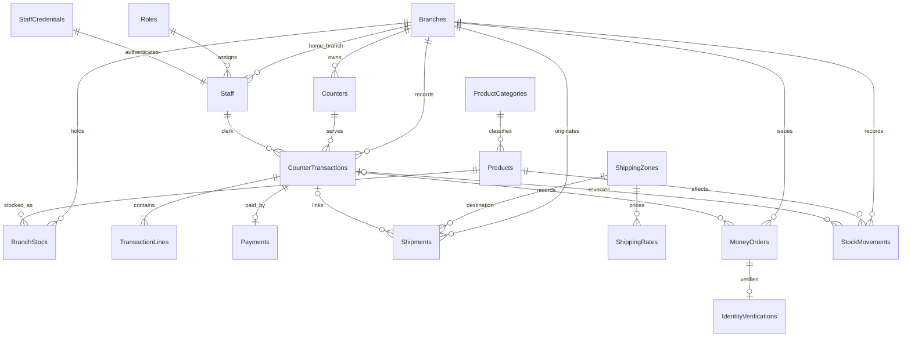

# Week 3 Phase 1: SQL Server Relational Design

**Status:** historical Phase 1 design proposal. The EF Core implementation and current verification status are recorded in [WEEK3-EF-IMPLEMENTATION.md](WEEK3-EF-IMPLEMENTATION.md).

## Design principles

- Target SQL Server LocalDB database `ApexPostDb` for local development, using EF Core 10 in the later implementation phase.
- Keep the existing dependency direction: Domain has no external dependencies; Application owns repository and Unit of Work contracts; Infrastructure owns EF Core and SQL mappings; Web remains the composition root.
- Preserve existing business invariants and sale-time values. Do not alter domain constructors or business rules solely for EF convenience.
- Use `varchar` for stable codes and enum codes, `nvarchar` for human text, `decimal(18,2)` for all money, `date` for business dates, `time` for local branch opening hours, and UTC `datetime2(7)` for event timestamps.
- The existing domain uses INR and rounds Money to two fractional digits. Do not introduce multi-currency or payment-card storage without a requirement.
- Use SQL foreign keys, unique constraints, check constraints, and transactions for integrity. Prefer `NO ACTION`/restrict deletion for historical and financial records.
- Every table below carries `CreatedAtUtc datetime2(7)` and `CreatedBy varchar(128) NULL`. For new rows, default `CreatedAtUtc` to `SYSUTCDATETIME()` and populate `CreatedBy` from the authenticated staff ID or a named migration actor. Both are nullable for imported legacy rows whose creation time/actor is not evidenced; do not fabricate historical audit values. Do not use those defaults to invent transaction occurrence times.
- `ModifiedAtUtc datetime2(7) NULL` is used on mutable records. `rowversion` is proposed only for `BranchStock` and `CounterTransactions`, as required. It is a concurrency token, not a date/time.

## Proposed tables

The required assignment tables are included. `StaffCredentials` preserves the existing separate credential store. `StockMovements` is a proposed addition to preserve quantity-change history and give stock reversals a durable, unique operation record; confirm it in Phase 2 before coding. `SyncInbox` is described as a deferred future extension and is not in the Phase 2 initial migration unless scope changes.

| Table | Primary key and important columns | Relationships and cardinality | Constraints and delete behavior | Modified / concurrency |
|---|---|---|---|---|
| `Branches` | `BranchCode varchar(10)`; `Name nvarchar(200)`, `Region nvarchar(100)`, `OpeningTime time`, `ClosingTime time`, `IsActive bit` | One branch to many counters, staff, stock rows, and transactions; optional branch on a standalone shipment/order where supported | Unique PK; nonempty name/region; `ClosingTime > OpeningTime`; `IsActive` default `1`; referenced branch is `NO ACTION` on delete | `ModifiedAtUtc`; no rowversion |
| `Counters` | `CounterId varchar(128)`; `BranchCode varchar(10)`, `Name nvarchar(200)`, `IsActive bit` | Many counters to one branch; one counter to many transactions | FK Branch `NO ACTION`; unique PK; nonempty name; `IsActive` default `1`; no cascade | `ModifiedAtUtc`; no rowversion |
| `Roles` | `RoleCode varchar(32)`; `Name nvarchar(100)` | One role to many staff rows | Seed the four existing role codes; unique PK; code check against approved enum values; referenced role `NO ACTION` on delete | Seeded static reference data; common creation columns; no rowversion |
| `Staff` | `StaffId varchar(128)`; `Name nvarchar(200)`, `Email nvarchar(320)`, `RoleCode varchar(32)`, `HomeBranchCode varchar(10)`, `IsActive bit` | Many staff to one role and one home branch; one staff to many transactions | FKs Role and Branch `NO ACTION`; active default `1`; unique PK. Email unique only after confirming normalization/case policy from requirements; current code does not establish it. No physical delete of historical actors | `ModifiedAtUtc`; no rowversion |
| `StaffCredentials` | `StaffId varchar(128)` PK/FK; `PasswordHash nvarchar(512)` (size to be confirmed against hasher output) | One-to-one with Staff | FK Staff `NO ACTION`; hash nonempty; no cascade; never store raw password or tokens | `ModifiedAtUtc` when password changes; no rowversion |
| `ProductCategories` | `CategoryCode varchar(32)`; `Name nvarchar(100)` | One category to many products | Seed enum-compatible categories; unique PK; constrained code; Product FK `NO ACTION` | Static reference table; no rowversion |
| `Products` | `Sku varchar(20)` PK; `Name nvarchar(200)`, `CategoryCode varchar(32)`, `UnitPrice decimal(18,2)`, `TaxCategory varchar(32)`, `IsActive bit` (if soft retirement is approved) | Many products to one category; one product to many stock rows | FK Category `NO ACTION`; price `>= 0`; tax category constrained to existing values. Do not add `IsActive` unless retirement behavior is explicitly approved | `ModifiedAtUtc` if catalog editing is enabled; no rowversion |
| `BranchStock` | Composite PK `(BranchCode varchar(10), Sku varchar(20))`; `Quantity int` | Many stock rows to one branch and one product | FKs Branch/Product `NO ACTION`; `Quantity >= 0`; unique composite key; no default masking a missing imported quantity | `ModifiedAtUtc`; required `rowversion` |
| `ShippingZones` | `ZoneCode varchar(32)`; `Name nvarchar(100)` (display name optional) | One zone to many rates and shipments | Unique PK; nonempty code; referenced zone `NO ACTION` | `ModifiedAtUtc` if editable; no rowversion |
| `ShippingRates` | Composite PK `(ZoneCode varchar(32), ServiceLevel varchar(32))`; `BasePrice decimal(18,2)`, `PricePerKilogram decimal(18,2)` | Many rates to one zone; one configured rate per zone/service-level pair | FK Zone `NO ACTION`; unique composite key; prices `>= 0`; service level constrained to existing values | `ModifiedAtUtc`; no rowversion |
| `Shipments` | `ShipmentId varchar(128)`; `ItemType varchar(16)`, `WeightKg decimal(9,3)`, dimensions `decimal(9,2)`, `ZoneCode varchar(32)`, `ServiceLevel varchar(32)`, nullable `BranchCode`, nullable `CounterTransactionId`, `CourierStatus nvarchar(100)`, nullable `CourierStatusUpdatedAtUtc` | Many shipments to one zone; optionally one branch and one transaction; transaction may have zero or one shipment in current sale workflow | FKs use `NO ACTION`; positive dimensions, nonnegative weight, item type Parcel/Letter; service-level check; no cascade from transaction/branch | `ModifiedAtUtc` for status changes; no rowversion required by brief |
| `MoneyOrders` | `MoneyOrderId varchar(128)`; `Amount decimal(18,2)`, `Fee decimal(18,2)`, `SenderName nvarchar(200)`, `RecipientName nvarchar(200)`, nullable `BranchCode`, nullable `TransactionId`, nullable `CreatedAtUtc` (business occurrence) | Many orders to one branch; optional transaction link; zero/one verification per order | FKs use `NO ACTION`; amount `> 0`, fee `>= 0`; unique transaction link only if one-order-per-sale remains a verified invariant; no cascade | `ModifiedAtUtc` only if current lifecycle supports edits; otherwise append/retain; no rowversion |
| `IdentityVerifications` | `VerificationId varchar(128)`; unique `MoneyOrderId varchar(128)`; `DocumentType nvarchar(100)`, `MaskedDocumentNumber varchar(8)`, `IsVerified bit`, `VerifiedAtUtc datetime2(7)` | One verification to one money order; an order may have zero or one verification | FK MoneyOrder `NO ACTION`; mask check exactly `XXXX` plus four alphanumeric characters; no full document number column, no cascade | Immutable after successful sale; no rowversion |
| `CounterTransactions` | `TransactionId varchar(128)`; `BranchCode`, `CounterId`, `ClerkId`, `Status varchar(32)`, `Reason nvarchar(500) NULL`, nullable `OccurredAtUtc`, captured `Subtotal/Tax/Total decimal(18,2)` | Many transactions to branch, counter, and clerk; one transaction to many lines; one transaction to zero/one payment | FKs Branch/Counter/Staff `NO ACTION`; status constrained to Open/Paid/Voided/Refunded; nonnegative totals; no cascading deletion; Paid-to-void/refund transitions remain domain/service rules | `ModifiedAtUtc` on reversal; required `rowversion` |
| `TransactionLines` | `TransactionLineId bigint` identity; `TransactionId`, `LineNumber int`, `Description nvarchar(500)`, `ItemType varchar(16)`, `Quantity int`, `UnitPrice/LineTotal decimal(18,2)`, `TaxCategory varchar(32)`, nullable `ReferenceId varchar(128)`, nullable typed FKs `ProductSku`, `ShipmentId`, `MoneyOrderId` | Many lines to one transaction; optional Product/Shipment/MoneyOrder references | Transaction FK `NO ACTION`; optional FKs `NO ACTION`; unique `(TransactionId, LineNumber)`; quantity `> 0`, prices `>= 0`, item type Retail/Service. Keep description and price snapshots even when a current catalog row exists | Immutable after payment; no rowversion |
| `Payments` | `TransactionId varchar(128)` PK/FK; `Method varchar(16)`, `Amount decimal(18,2)`, `PaidAtUtc datetime2(7)` | One payment to one transaction in current single-full-payment model | FK Transaction `NO ACTION`; method check Cash/Card/Upi; amount `>= 0`; no card number/token fields; no cascade | Immutable after sale; no rowversion |
| `StockMovements` *(proposed)* | `MovementId bigint` identity; branch, SKU, signed `QuantityDelta int`, `MovementType varchar(24)`, optional `TransactionId`, `ActorStaffId`, `Reason`, before/after quantity | Many movements to one branch and product; optional source transaction and actor | FKs use `NO ACTION`; delta nonzero; unique filtered `(TransactionId, MovementType)` for reversal types, so one reversal restoration per transaction/type; stock row and movement commit together | Append-only; no rowversion |
| `AuditEntries` | `AuditEntryId bigint` identity; event time, staff/role/branch snapshots, controller/action, safe transaction/shipment/stock identifiers, status, duration, correlation ID | Many audit records may refer to one staff/branch/transaction/shipment, but identifiers are retained as event snapshots rather than delete-sensitive FKs | Append-only; no update/delete API; lengths bounded; no body, password, token, API key, card data, or full identity number; no cascade | `CreatedAtUtc` is event time; no ModifiedAtUtc or rowversion |
| `SyncInbox` *(deferred)* | Future candidate: `MessageId uniqueidentifier`, device ID, received UTC time, idempotency key, payload hash, payload, processing state/time | Future device messages may reference domain entities; exact relationships unknown until offline-sync scope is approved | Not part of the initial SQL migration. If later approved: unique idempotency key, bounded payload, retry/status constraints, retention and privacy decisions first | Future immutable receipt plus mutable processing state; concurrency design deferred |

`Products.IsActive` is only a possible soft-retirement field: the current Product domain has no active flag. Do not add it unless a confirmed requirement needs retirement. `StockMovements` is a justified proposal because the current audit record for stock adjustments keeps branch and SKU but not the quantity delta, while a durable reversal key is needed to avoid relying on process memory. If the trainer does not require movement history, the alternative is a transaction-row lock plus atomic inventory update and state transition; do not add both mechanisms without a reason.

### Delete and retention rules

Branch, staff, role, product, category, zone and counter rows referenced by operational/history data are deactivated or retained, not physically deleted. Financial transactions, line items, payments, money orders, verifications, stock movements and audit entries are never cascade-deleted. Shipment retention must preserve receipt and tracking history; if the domain later permits cancellation, use a status transition rather than deleting a shipment. SQL `NO ACTION` is the safe default for all these references. The user’s Week 3 request expressly prohibits cascade deletion of financial transactions and audit history.

### Normalization and deliberate snapshots

Branch, counter, staff, product/category, stock, zone/rate, shipment, money order, verification, transaction, payment and audit facts are separate relations. This removes current repeated reference data and creates enforceable relationships. A product name/price and tax rate must not be re-read to recreate an old receipt: transaction line description, quantity, unit price, tax category, calculated line total, transaction totals, and captured tax rates remain sale-time snapshots. Audit actor/role/branch values are event-time snapshots; retaining them is preferable to changing historical meaning after a staff transfer or role change.

`ReferenceId` is polymorphic today. During import, preserve its original text exactly; resolve retail SKU and shipment-service references into typed nullable FKs only when the target exists and the line type makes that interpretation valid. Money-order service lines currently have no `ReferenceId`, so join them through the transaction/order relationship. Do not infer a missing reference. A check constraint should prevent more than one typed FK from being set; any remaining unrecognized legacy reference stays in the original snapshot/import report for manual review, not silently discarded.

The present domain has no `Payment` entity and represents payment method on the transaction; `Payments` is an assignment-required persistence normalization for the current full single payment. Keep the Domain type unchanged unless a later feature needs payment lifecycle behavior. Likewise, `Roles` maps the existing `StaffRole` enum; its values should be seeded reference data, not a Domain redesign.

## EF Core and Domain separation

In the later implementation, put EF Core packages and `ApexPostDbContext` in Infrastructure. Map simple entities with Fluent API and value converters (`BranchCode.Value` to `varchar`, `Sku.Value` to `varchar`, `Money.Amount` to `decimal(18,2)`, enum values to constrained strings). Map `CounterTransaction`/`TransactionLineItem` carefully because the aggregate owns a private collection and line items lack persistence keys; a small Infrastructure persistence row model and mapper is preferable to adding EF attributes or setters to Domain. Map captured tax rates as their own transaction children or an equivalent owned collection so historical calculations remain reproducible. Keep credentials in a separate persistence mapping.

Tracked aggregate reads are appropriate for sale preparation, transaction reversal, staff profile changes, stock adjustment and shipment status updates. Reports, dashboards, lists and auditor searches should use `AsNoTracking` DTO projections; use the Infrastructure query adapter behind Application query ports such as `IReportDataSource`. A repository must not return `IQueryable`.

Add `IUnitOfWork` in Application; implement it in Infrastructure against one scoped `ApexPostDbContext`. All repositories in one request scope resolve that same context. Repository `Add/Update` methods stage changes only and never call `SaveChangesAsync`. One successful business use case calls one commit. The relational provider wraps one `SaveChangesAsync` batch in a database transaction; use an explicit transaction only where multiple database rounds are proven necessary. Keep the audit append as a separate post-action write by default so an audit-store failure does not turn a completed sale/reversal into an HTTP error; surface/log the failure honestly.

Keep read methods that fit the existing repository ports. Minimal port changes are expected where an operation must be atomic, especially stock reservation/adjustment and transaction reversal. Add only focused query methods/ports needed to avoid loading every row for reports. Do not introduce a generic specification framework unless real queries need it. No repository returns `IQueryable`.

## Proposed ER diagram

The audit table intentionally records event-time identifiers without restrictive foreign keys, allowing history to survive deactivation and retention. `SyncInbox` is omitted from the ER diagram because it is deferred and no device or synchronization contract exists in the current scope.

## Performance workload hypotheses

These are index candidates, not measured improvements. Later work must inspect actual execution plans, logical reads, CPU time and representative row counts before claiming a benefit.

| Workload | Filters / joins / sort | Candidate index | Filtered index and write cost |
|---|---|---|---|
| Low stock by branch | `BranchStock.BranchCode`, `Quantity <= @reorder`; join Products by SKU; order BranchCode, SKU | Existing PK `(BranchCode, Sku)` plus candidate `(BranchCode, Quantity, Sku) INCLUDE (ModifiedAtUtc)` | A fixed-threshold filtered index is unsuitable while reorder level is configurable. Extra index costs on every stock update. |
| Daily sales by branch/date | `BranchCode = @branch`, `OccurredAtUtc >= @start AND < @end`, paid status; join transaction lines by transaction; group line category | `CounterTransactions(BranchCode, OccurredAtUtc, Status) INCLUDE (Subtotal, Tax, Total)` and `TransactionLines(TransactionId, ItemType) INCLUDE (LineTotal, Quantity)` | Filtered Paid index could help only if status predicate/selectivity supports it after measurement; reversals update status and incur maintenance. |
| Shipment search by zone/service | Zone and service equality; optional created-time range; sort newest first; join branch/transaction if displayed | `Shipments(ZoneCode, ServiceLevel, CreatedAtUtc DESC) INCLUDE (ShipmentId, BranchCode, CourierStatus)` | No filtered index until a stable status query exists. Courier status updates maintain included columns. |
| Auditor money-order search | Optional BranchCode and CreatedAtUtc range; sort by time/order ID; join verification by MoneyOrderId | `MoneyOrders(BranchCode, CreatedAtUtc, MoneyOrderId) INCLUDE (Amount, Fee, TransactionId)`; `IdentityVerifications(MoneyOrderId)` unique | Filter only if auditor queries always constrain a stable state; no state currently exists. Added index increases insert cost and stores sensitive adjacent business data, so control access. |

The current daily report already expresses date filtering as a half-open UTC interval (`>= start`, `< next-day start`), a SARGable shape to keep in SQL. Avoid applying `Date`, `CAST`, or `CONVERT` to the indexed timestamp column.
