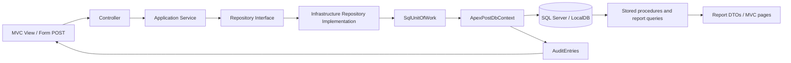

# Week 3 Technical Architecture

## 1. Request-to-database flow

The actual runtime flow is as follows:

The composition is intentionally consistent with the Week 2 design: the web layer handles HTTP concerns, the application layer owns business logic, the infrastructure layer owns SQL, and the domain layer contains business invariants.

## 2. Project responsibilities

### Domain project

`src/ApexPost.Domain`

Responsibilities:

- domain entities and value objects
- rich business rules and invariants
- status enums and calculation logic
- branch, stock, money-order, transaction, shipment rules

Examples:

- `src/ApexPost.Domain/Entities/Branch.cs`
- `src/ApexPost.Domain/Entities/CounterTransaction.cs`
- `src/ApexPost.Domain/Entities/InventoryStock.cs`
- `src/ApexPost.Domain/Entities/MoneyOrder.cs`
- `src/ApexPost.Domain/ValueObjects/Money.cs`

### Application project

`src/ApexPost.Application`

Responsibilities:

- service layer behavior
- repository interfaces
- report contracts
- security contracts
- validation and command patterns

Examples:

- `src/ApexPost.Application/Services/Transactions/CounterSaleService.cs`
- `src/ApexPost.Application/Abstractions/Repositories/*`
- `src/ApexPost.Application/Abstractions/Persistence/IUnitOfWork.cs`
- `src/ApexPost.Application/Abstractions/Reports/IReportDataSource.cs`

### Infrastructure project

`src/ApexPost.Infrastructure`

Responsibilities:

- SQL Server EF Core configuration
- repository implementations
- Unit of Work implementation
- stored procedure execution helpers
- import and diagnostics support

Examples:

- `src/ApexPost.Infrastructure/Persistence/ApexPostDbContext.cs`
- `src/ApexPost.Infrastructure/Persistence/Repositories/SqlRepositories.cs`
- `src/ApexPost.Infrastructure/Persistence/SqlUnitOfWork.cs`
- `src/ApexPost.Infrastructure/Persistence/JsonDataImporter.cs`

### Web project

`src/ApexPost.Web`

Responsibilities:

- MVC endpoints
- request handling and view rendering
- cookie auth and authorization policy setup
- middleware, filters, and rate limiting
- app composition root

Examples:

- `src/ApexPost.Web/Program.cs`
- `src/ApexPost.Web/DependencyInjection.cs`
- `src/ApexPost.Web/Controllers/*.cs`
- `src/ApexPost.Web/Middleware/*.cs`

## 3. Dependency injection and runtime registration

The runtime composition is handled in the Web startup path:

- `src/ApexPost.Web/Program.cs`

The app configures services in this order:

1. MVC and controller support
2. Application services
3. SQL infrastructure (`AddSqlInfrastructure`)
4. SQL and counter-sale configuration
5. Web security and policies

The production SQL registration is:

- `src/ApexPost.Infrastructure/Persistence/SqlInfrastructureExtensions.cs`

This method:

- reads `APEXPOST_SQL_CONNECTION` first
- falls back to `ConnectionStrings:ApexPost`
- throws an exception if neither is configured
- registers `ApexPostDbContext` with EF Core SQL Server
- registers the scoped Unit of Work and repository implementations

This is the actual SQL-only configuration currently used by the runtime.

## 4. DbContext lifetime and repository scope

The SQL runtime uses scoped lifetime for the data access stack:

- `AddDbContext<ApexPostDbContext>(...)`
- `AddDbContextFactory<ApexPostDbContext>(...)`
- `services.TryAddScoped<IUnitOfWork, SqlUnitOfWork>()`
- scoped repository registrations

This ensures that each request or request-scoped operation shares a single context while avoiding cross-request leakage. This matches the expected repository and Unit of Work pattern: one DbContext per request scope and one commit per use case.

## 5. Repository interfaces and implementations

The application owns repository contracts, and infrastructure implements them behind the same domain interfaces.

Examples:

- `IBranchRepository` -> `SqlBranchRepository`
- `IProductRepository` -> `SqlProductRepository`
- `IInventoryRepository` -> `SqlInventoryRepository`
- `ICounterTransactionRepository` -> `SqlCounterTransactionRepository`
- `IShipmentRepository` -> `SqlShipmentRepository`
- `IMoneyOrderRepository` -> `SqlMoneyOrderRepository`
- `IAuditStore` -> `SqlAuditStore`
- `IReportDataSource` -> `SqlReportDataSource`

Repository behavior:

- no `IQueryable` returned to callers
- no direct `SaveChanges` inside repositories
- changes are staged on the shared `ApexPostDbContext`
- persistence is committed through `IUnitOfWork`

## 6. Transaction boundaries

Transactions are explicit and deliberate.

The Unit of Work implementation provides:

- `SaveChangesAsync()` for standard operations
- `ExecuteInTransactionAsync()` via EF Core execution strategy and `BeginTransactionAsync()`

The database layer also performs rollback and cleanup on error paths. In the stock adjustment logic, `usp_AdjustStock` is invoked through a parameterized call and the procedure itself uses `XACT_ABORT`, `TRY/CATCH`, and validation before changes are committed.

This preserves integrity in mixed save and stored-procedure workflows, especially for stock updates and cross-entity transactional writes.

## 7. Error handling and concurrency semantics

`SqlUnitOfWork` catches `DbUpdateConcurrencyException` and converts it to a `ConcurrencyConflictException`.

This is used to translate database-level concurrency failures into a user-safe application-level message and an expected conflict state rather than a raw database exception leak.

The application also keeps validation and authorization in the service and controller layers. The SQL stored procedures guard invalid values and impossible stock reductions before commit.

## 8. SQL-only Web runtime

The Web runtime is established as SQL-only through `AddSqlInfrastructure` and `UseSqlServer`. The application does not use JSON-backed repository registrations in the startup path for the production business runtime.

The runtime dependency chain is therefore:

- controller request
- application service
- repository interface
- SQL repository implementation
- EF Core `ApexPostDbContext`
- SQL Server database

This is the core architecture guarantee behind the Week 3 database implementation.

## 9. Security and request flow

The Web runtime adds authentication and authorization through the security configuration, with middleware enforcing observability, maintenance behavior, and request safety. This includes:

- request correlation IDs
- secure headers
- exception handling
- rate limiting
- health check at `/health`
- middleware-based API-key validation and IP restrictions

These are layered around the application flow and composed before the MVC pipeline continues.

## 10. Final architecture statement

The current implementation meets the Week 3 assignment intent by delivering a real relational persistence boundary with disciplined layering, explicit EF Core and SQL Server integration, and preserved business correctness. It remains faithful to the Week 2 architecture and avoids introducing the excluded features that would otherwise broaden the project beyond the assignment scope.
